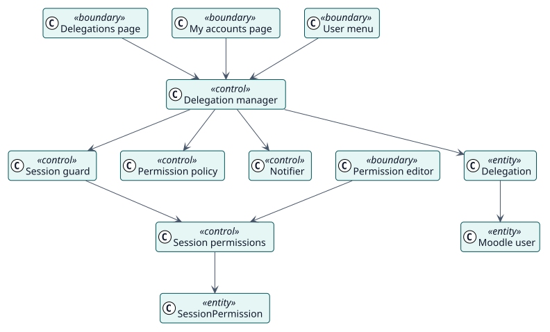

# Analysis

## Analysis classes

Stereotypes: `<<boundary>>` interface, `<<control>>` coordination, `<<entity>>` domain information.

| Class | Stereotype | Responsibility |
| --- | --- | --- |
| Delegations page, My accounts page, Permission editor, User menu | boundary | The screens through which administrators and authorised users work. |
| Delegation manager | control | Creates, updates and revokes delegations, decides whether access is allowed and starts the session. |
| Session guard | control | Verifies a delegated session on every request and ends it when it is no longer valid. |
| Permission policy | control | Maps each action of the plugin to its capability. |
| Session permissions | control | Stores the overrides and applies them to the access data of a session. |
| Notifier | control | Builds and sends the messages about a delegation. |
| Delegation, Session permission | entity | The stored information. |

## Use-case realizations

| ID | Use case | Collaboration |
| --- | --- | --- |
| UC-001 | [Create delegations](./use-cases/createDelegations/README.md) | [collaboration](./use-cases/createDelegations/collaboration.svg) |
| UC-002 | [Open a delegated account](./use-cases/openDelegatedAccount/README.md) | [collaboration](./use-cases/openDelegatedAccount/collaboration.svg) |
| UC-003 | [Edit session permissions](./use-cases/editSessionPermissions/README.md) | [collaboration](./use-cases/editSessionPermissions/collaboration.svg) |
| UC-004 | [Revoke delegations](./use-cases/revokeDelegations/README.md) | [collaboration](./use-cases/revokeDelegations/collaboration.svg) |
| UC-005 | [Review delegated activity](./use-cases/reviewActivity/README.md) | [collaboration](./use-cases/reviewActivity/collaboration.svg) |
