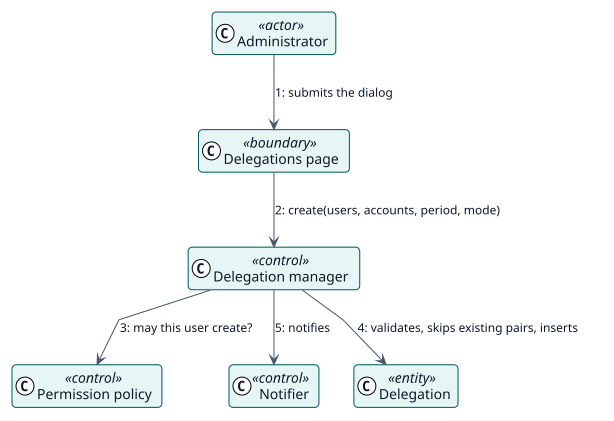

# UC-001 Create delegations — analysis realization

| Overview | Requirements | Analysis | Design | Implementation | Tests |
| --- | --- | --- | --- | --- | --- |
| [Use cases](../../../requirements/use-case-overview.svg) | [Requirements](../../../requirements/use-cases/createDelegations/README.md) | **Analysis** | [Design](../../../design/use-cases/createDelegations/README.md) | [Implementation](../../../implementation/use-cases/createDelegations/README.md) | [Tests](../../../implementation/use-cases/createDelegations/README.md#tests) |

Requirements: [README](../../../requirements/use-cases/createDelegations/README.md)

## Participating classes

| Class | Stereotype | Responsibility |
| --- | --- | --- |
| Delegations page | boundary | Collects users, accounts, period and mode. |
| Delegation manager | control | Validates, applies limits and inserts in one transaction. |
| Permission policy | control | Checks the capability to create. |
| Notifier | control | Sends the messages after the transaction commits. |
| Delegation | entity | The stored record. |

## Collaboration

## Notes

Skipping existing pairs and self-delegations is a rule of the manager, not of the screen. The notification is sent after the commit, so a failed message never undoes a delegation.
