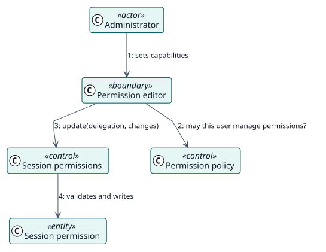

# UC-003 Edit session permissions — analysis realization

| Overview | Requirements | Analysis | Design | Implementation | Tests |
| --- | --- | --- | --- | --- | --- |
| [Use cases](../../../requirements/use-case-overview.svg) | [Requirements](../../../requirements/use-cases/editSessionPermissions/README.md) | **Analysis** | [Design](../../../design/use-cases/editSessionPermissions/README.md) | [Implementation](../../../implementation/use-cases/editSessionPermissions/README.md) | [Tests](../../../implementation/use-cases/editSessionPermissions/README.md#tests) |

Requirements: [README](../../../requirements/use-cases/editSessionPermissions/README.md)

## Participating classes

| Class | Stereotype | Responsibility |
| --- | --- | --- |
| Permission editor | boundary | Shows and edits the overrides. |
| Permission policy | control | Checks `managepermissions`. |
| Session permissions | control | Validates, stores and applies overrides. |
| Session permission | entity | One override of one capability. |

## Collaboration

## Notes

Overrides are applied to the access data of the session on every request, not baked into a role, so a change reaches open sessions from their next page.
