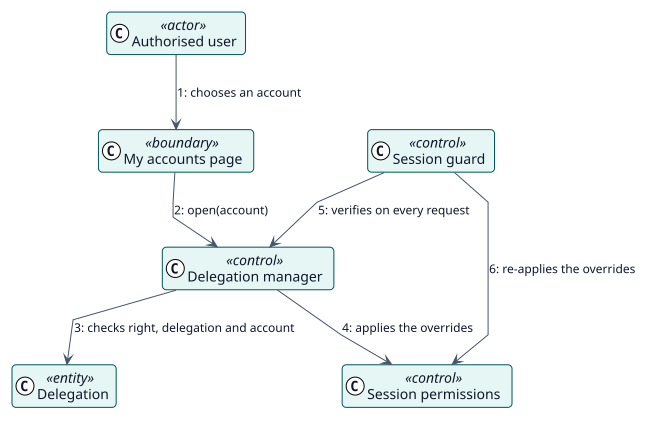

# UC-002 Open a delegated account — analysis realization

| Overview | Requirements | Analysis | Design | Implementation | Tests |
| --- | --- | --- | --- | --- | --- |
| [Use cases](../../../requirements/use-case-overview.svg) | [Requirements](../../../requirements/use-cases/openDelegatedAccount/README.md) | **Analysis** | [Design](../../../design/use-cases/openDelegatedAccount/README.md) | [Implementation](../../../implementation/use-cases/openDelegatedAccount/README.md) | [Tests](../../../implementation/use-cases/openDelegatedAccount/README.md#tests) |

Requirements: [README](../../../requirements/use-cases/openDelegatedAccount/README.md)

## Participating classes

| Class | Stereotype | Responsibility |
| --- | --- | --- |
| My accounts page | boundary | Lists the accounts and starts the session. |
| Delegation manager | control | Decides access and starts login-as. |
| Session guard | control | Verifies the session on every request. |
| Session permissions | control | Applies the overrides to the session. |
| Delegation | entity | The record that allows the session. |

## Collaboration

## Notes

The marker of a delegated session lives in `$SESSION` and not in a cache, because Moodle replaces `$SESSION` when login-as starts. The same checks run when the session starts and on every later request.
