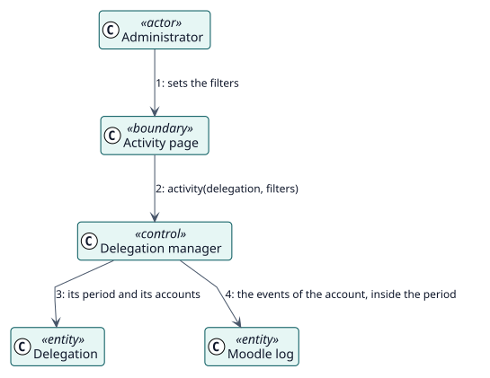

# UC-005 Review delegated activity — analysis realization

| Overview | Requirements | Analysis | Design | Implementation | Tests |
| --- | --- | --- | --- | --- | --- |
| [Use cases](../../../requirements/use-case-overview.svg) | [Requirements](../../../requirements/use-cases/reviewActivity/README.md) | **Analysis** | [Design](../../../design/use-cases/reviewActivity/README.md) | [Implementation](../../../implementation/use-cases/reviewActivity/README.md) | [Tests](../../../implementation/use-cases/reviewActivity/README.md#tests) |

Requirements: [README](../../../requirements/use-cases/reviewActivity/README.md)

## Participating classes

| Class | Stereotype | Responsibility |
| --- | --- | --- |
| Activity page | boundary | Collects the filters and shows the events. |
| Delegation manager | control | Selects the events of the account in the period. |
| Delegation | entity | Gives the period and the accounts. |
| Moodle log | entity | Holds the events. |

## Collaboration

## Notes

The plugin reads the log of Moodle and writes none of its own for this report.
