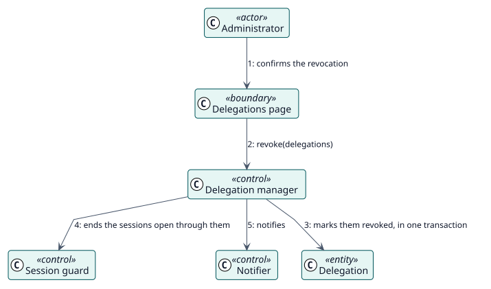

# UC-004 Revoke delegations — analysis realization

| Overview | Requirements | Analysis | Design | Implementation | Tests |
| --- | --- | --- | --- | --- | --- |
| [Use cases](../../../requirements/use-case-overview.svg) | [Requirements](../../../requirements/use-cases/revokeDelegations/README.md) | **Analysis** | [Design](../../../design/use-cases/revokeDelegations/README.md) | [Implementation](../../../implementation/use-cases/revokeDelegations/README.md) | [Tests](../../../implementation/use-cases/revokeDelegations/README.md#tests) |

Requirements: [README](../../../requirements/use-cases/revokeDelegations/README.md)

## Participating classes

| Class | Stereotype | Responsibility |
| --- | --- | --- |
| Delegations page | boundary | Chooses the delegations and asks for confirmation. |
| Delegation manager | control | Revokes in one transaction. |
| Session guard | control | Ends the sessions that are open through the delegations. |
| Notifier | control | Sends the messages after the transaction commits. |
| Delegation | entity | The record, now revoked. |

## Collaboration

## Notes

The sessions are ended after the transaction commits; a session that was not remembered still ends at its next request, because every request is checked.
