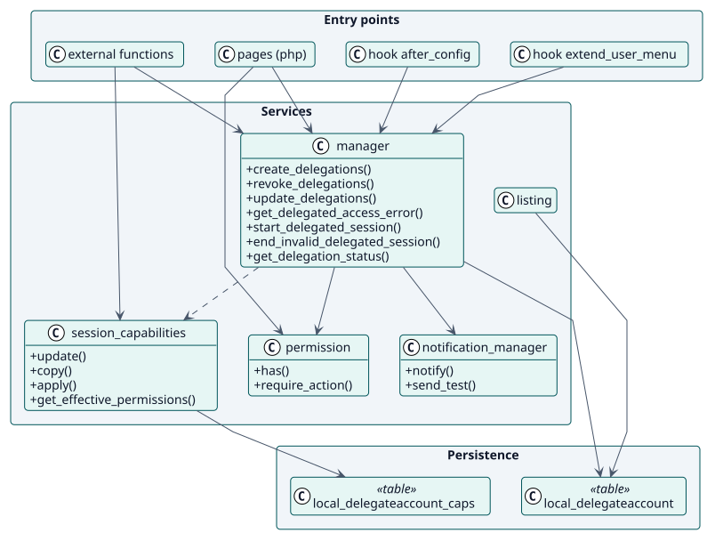
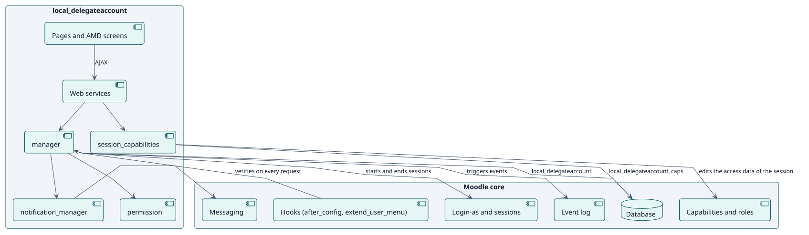
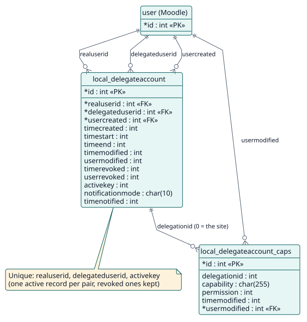

# Design

## Architecture

Delegate Account is a Moodle local plugin with three layers:

- **Entry points**: web-service functions (`classes/external/`), pages (`pages/`), and two hooks (`after_config`, `extend_user_menu`).
- **Services**: static classes in `classes/`. `manager` holds the rules of delegations, `session_capabilities` stores and applies overrides, `notification_manager` sends messages, `permission` maps actions to capabilities.
- **Persistence**: two tables, `local_delegateaccount` and `local_delegateaccount_caps`.

Two decisions shape the design. First, access is **re-evaluated on every request** by a hook, so a revoked delegation ends its sessions without a background job. Second, session permissions are **applied to the access data of the session**, not stored in roles, so they can be changed while sessions are open and never leave a role behind.

## Design classes

## Components

The plugin sits on five parts of Moodle: login-as, the capability system, the event log, messaging and the database. It adds no table to them and no change to core.

## Data model

## Use-case realizations

| ID | Use case | Sequence |
| --- | --- | --- |
| UC-001 | [Create delegations](./use-cases/createDelegations/README.md) | [sequence](./use-cases/createDelegations/sequence.svg) |
| UC-002 | [Open a delegated account](./use-cases/openDelegatedAccount/README.md) | [sequence](./use-cases/openDelegatedAccount/sequence.svg) |
| UC-003 | [Edit session permissions](./use-cases/editSessionPermissions/README.md) | [sequence](./use-cases/editSessionPermissions/sequence.svg) |
| UC-004 | [Revoke delegations](./use-cases/revokeDelegations/README.md) | [sequence](./use-cases/revokeDelegations/sequence.svg) |
| UC-005 | [Review delegated activity](./use-cases/reviewActivity/README.md) | [sequence](./use-cases/reviewActivity/sequence.svg) |
