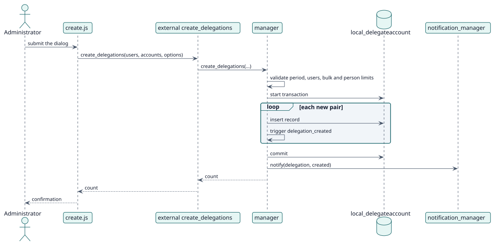

# UC-001 Create delegations — design realization

| Overview | Requirements | Analysis | Design | Implementation | Tests |
| --- | --- | --- | --- | --- | --- |
| [Use cases](../../../requirements/use-case-overview.svg) | [Requirements](../../../requirements/use-cases/createDelegations/README.md) | [Analysis](../../../analysis/use-cases/createDelegations/README.md) | **Design** | [Implementation](../../../implementation/use-cases/createDelegations/README.md) | [Tests](../../../implementation/use-cases/createDelegations/README.md#tests) |

Analysis: [README](../../../analysis/use-cases/createDelegations/README.md)

## Elements

| Design element | Kind | Code target |
| --- | --- | --- |
| `create_delegations` external function | service | `classes/external/create_delegations.php` |
| `manager::create_delegations` | service | `classes/manager.php` |
| `manager::validate_users`, `validate_period`, `validate_delegation_limit` | validation | `classes/manager.php` |
| `notification_manager::notify` | service | `classes/notification_manager.php` |
| `delegation_created` event | event | `classes/event/delegation_created.php` |

## Sequence

## Contracts

| Operation | Input | Output | Errors |
| --- | --- | --- | --- |
| `create_delegations(realuserids, delegateduserids, options)` | user ids, `timestart`, `timeend`, `notificationmode` | number of delegations created | invalid period, invalid users, bulk limit, limit per person |

## Data touched

| Table or entity | Operation |
| --- | --- |
| `local_delegateaccount` | insert |
| `user` | read |
| `logstore_standard_log` | insert (one event per delegation) |
