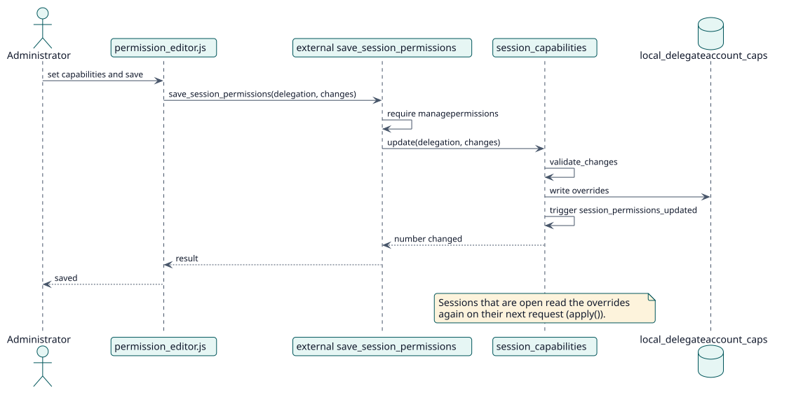

# UC-003 Edit session permissions — design realization

| Overview | Requirements | Analysis | Design | Implementation | Tests |
| --- | --- | --- | --- | --- | --- |
| [Use cases](../../../requirements/use-case-overview.svg) | [Requirements](../../../requirements/use-cases/editSessionPermissions/README.md) | [Analysis](../../../analysis/use-cases/editSessionPermissions/README.md) | **Design** | [Implementation](../../../implementation/use-cases/editSessionPermissions/README.md) | [Tests](../../../implementation/use-cases/editSessionPermissions/README.md#tests) |

Analysis: [README](../../../analysis/use-cases/editSessionPermissions/README.md)

## Elements

| Design element | Kind | Code target |
| --- | --- | --- |
| `save_session_permissions` and `update_session_permissions` external functions | service | `classes/external/` |
| `session_capabilities::update`, `replace`, `update_many`, `copy` | service | `classes/session_capabilities.php` |
| `session_capabilities::apply` | service | `classes/session_capabilities.php` |
| `session_permissions_updated` event | event | `classes/event/session_permissions_updated.php` |

## Sequence

## Contracts

| Operation | Input | Output | Errors |
| --- | --- | --- | --- |
| `session_capabilities::update(delegationid, changes)` | delegation id (0 is the site), capability to permission map | number of overrides changed | unknown capability, invalid permission |

## Data touched

| Table or entity | Operation |
| --- | --- |
| `local_delegateaccount_caps` | insert, update, delete |
| `capabilities` | read |
