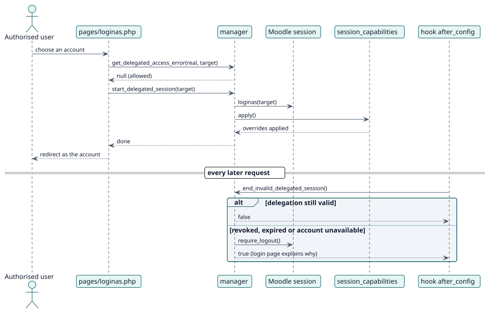

# UC-002 Open a delegated account — design realization

| Overview | Requirements | Analysis | Design | Implementation | Tests |
| --- | --- | --- | --- | --- | --- |
| [Use cases](../../../requirements/use-case-overview.svg) | [Requirements](../../../requirements/use-cases/openDelegatedAccount/README.md) | [Analysis](../../../analysis/use-cases/openDelegatedAccount/README.md) | **Design** | [Implementation](../../../implementation/use-cases/openDelegatedAccount/README.md) | [Tests](../../../implementation/use-cases/openDelegatedAccount/README.md#tests) |

Analysis: [README](../../../analysis/use-cases/openDelegatedAccount/README.md)

## Elements

| Design element | Kind | Code target |
| --- | --- | --- |
| `pages/loginas.php` | controller | `pages/loginas.php` |
| `manager::get_delegated_access_error` | service | `classes/manager.php` |
| `manager::start_delegated_session` | service | `classes/manager.php` |
| `hook\after_config` | hook | `classes/hook/after_config.php` |
| `hook\extend_user_menu` | hook | `classes/hook/extend_user_menu.php` |

## Sequence

## Contracts

| Operation | Input | Output | Errors |
| --- | --- | --- | --- |
| `get_delegated_access_error(realuserid, targetuserid)` | two user ids | null, or a language string id | `error_unauthorised`, `error_targetunavailable`, `error_privilegedtarget` |

## Data touched

| Table or entity | Operation |
| --- | --- |
| `local_delegateaccount` | read |
| `user` | read |
| `local_delegateaccount_caps` | read |
