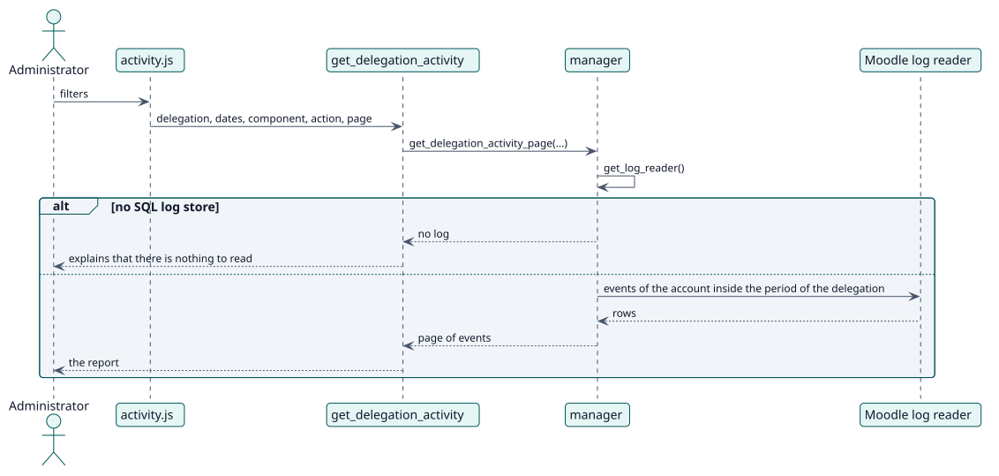

# UC-005 Review delegated activity — design realization

| Overview | Requirements | Analysis | Design | Implementation | Tests |
| --- | --- | --- | --- | --- | --- |
| [Use cases](../../../requirements/use-case-overview.svg) | [Requirements](../../../requirements/use-cases/reviewActivity/README.md) | [Analysis](../../../analysis/use-cases/reviewActivity/README.md) | **Design** | [Implementation](../../../implementation/use-cases/reviewActivity/README.md) | [Tests](../../../implementation/use-cases/reviewActivity/README.md#tests) |

Analysis: [README](../../../analysis/use-cases/reviewActivity/README.md)

## Elements

| Design element | Kind | Code target |
| --- | --- | --- |
| `manager::get_delegation_activity_page` | service | `classes/manager.php:961` |
| `manager::get_delegation_log_selector` | service | `classes/manager.php:907` |
| `get_delegation_activity` external function | service | `classes/external/get_delegation_activity.php` |

## Sequence

## Contracts

| Operation | Input | Output | Errors |
| --- | --- | --- | --- |
| `get_delegation_activity(delegation, filters, page)` | the delegation, the dates, the component, the action and the page | a page of events | delegation not found, no log |

## Data touched

| Table or entity | Operation |
| --- | --- |
| `logstore_standard_log` | read |
| `local_delegateaccount` | read |
