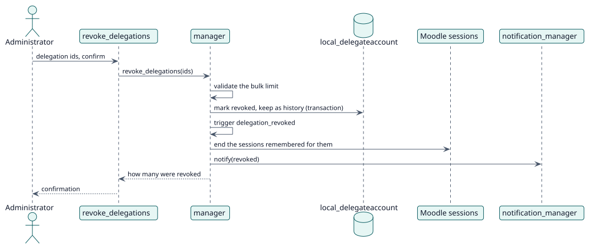

# UC-004 Revoke delegations — design realization

| Overview | Requirements | Analysis | Design | Implementation | Tests |
| --- | --- | --- | --- | --- | --- |
| [Use cases](../../../requirements/use-case-overview.svg) | [Requirements](../../../requirements/use-cases/revokeDelegations/README.md) | [Analysis](../../../analysis/use-cases/revokeDelegations/README.md) | **Design** | [Implementation](../../../implementation/use-cases/revokeDelegations/README.md) | [Tests](../../../implementation/use-cases/revokeDelegations/README.md#tests) |

Analysis: [README](../../../analysis/use-cases/revokeDelegations/README.md)

## Elements

| Design element | Kind | Code target |
| --- | --- | --- |
| `manager::revoke_delegations` | service | `classes/manager.php:516` |
| `manager::end_sessions` | service | `classes/manager.php:354` |
| `revoke_delegations` external function | service | `classes/external/revoke_delegations.php` |

## Sequence

## Contracts

| Operation | Input | Output | Errors |
| --- | --- | --- | --- |
| `revoke_delegations(ids, confirm)` | the ids and the confirmation | how many were revoked | bulk limit exceeded, no confirmation |

## Data touched

| Table or entity | Operation |
| --- | --- |
| `local_delegateaccount` | update |
| `logstore_standard_log` | insert (one event per delegation) |
| `sessions` | delete |
