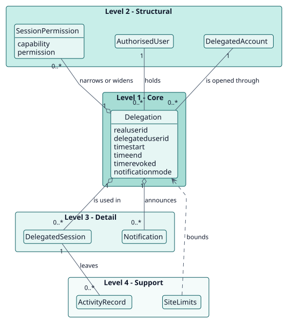
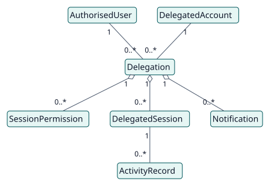
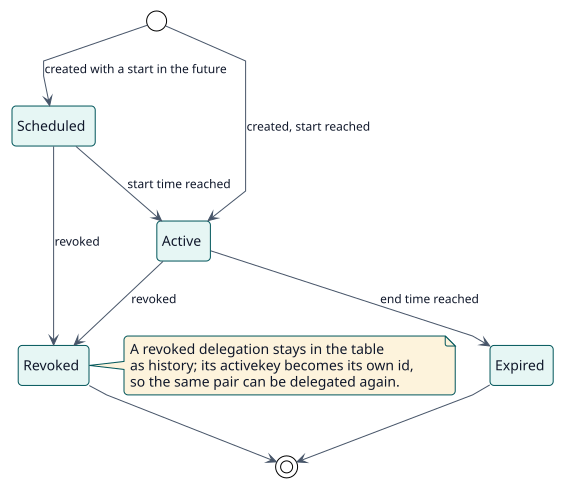

# Domain model

## Purpose

Moodle's **Log in as** lets a user open any account they can see, for as long as they like. Delegate Account narrows that to explicit pairs of people, each with a period, and records who created, changed and revoked each pair. This model names the concepts behind that decision. Everything in it was observed in the code (`observed`); what could not be settled from the code is in [open questions](../quality/open-questions.md).

## Hierarchy of entities

The vertical position of an entity expresses its importance to the project objective. It is not UML inheritance or composition.

| Level | Meaning | Entities | Why they are here |
| --- | --- | --- | --- |
| 1 | Core: the project cannot exist without them | Delegation | The plugin exists to decide, for a pair of users and a moment, whether access is allowed. |
| 2 | Structural: depend directly on the core | AuthorisedUser, DelegatedAccount, SessionPermission | A delegation links two accounts and may narrow or widen what the session can do. |
| 3 | Detail: qualify or specialise level 2 | DelegatedSession, Notification | They happen because of a delegation: the session that uses it and the messages that announce it. |
| 4 | Support: catalogues, audit, configuration | SiteLimits, ActivityRecord | They bound and observe delegations without changing their meaning. |

## Diagrams

## Entity dictionary

| Entity | Level | Definition | Key attributes | Omitted attributes and why |
| --- | --- | --- | --- | --- |
| Delegation | 1 | The permission of one authorised user to open one account, for a period. | `realuserid`, `delegateduserid`, `timestart`, `timeend`, `timerevoked`, `notificationmode` | Audit columns (`usercreated`, `usermodified`, `userrevoked`, `timecreated`, `timemodified`) are in the [data model](../design/data-model/data-model.svg). |
| AuthorisedUser | 2 | A person who may open delegated accounts: a site administrator or someone holding `local/delegateaccount:use`. | Moodle user, capability | It is Moodle's `user`, not a table of the plugin. |
| DelegatedAccount | 2 | The account that is opened. It must exist, be active and, by default, not be a site administrator. | Moodle user | It is Moodle's `user`, not a table of the plugin. |
| SessionPermission | 2 | An override of one capability for delegated sessions: allow, prevent or prohibit. It applies to one delegation or, with `delegationid` 0, to every delegated session of the site. | `delegationid`, `capability`, `permission` | |
| DelegatedSession | 3 | A Moodle login-as session started through a delegation, marked in `$SESSION`. | the delegation id | It lives in the session, not in a table. |
| Notification | 3 | The message sent to the authorised user, the delegated account or both when a delegation is created or revoked. | action, recipient language | The templates are plugin settings. |
| SiteLimits | 4 | The site settings that bound delegations: maximum per person, maximum duration, maximum per bulk action, protection of administrators. | `maxdelegationsperuser`, `maximumdurationdays`, `maxbulkoperations`, `protectprivilegedtargets` | |
| ActivityRecord | 4 | An event of Moodle's standard log written while a delegated session was open, read back by the activity report. | Moodle log row | It is Moodle's log, not a table of the plugin. |

## Business rules

| ID | Rule | Entities | Source |
| --- | --- | --- | --- |
| RN-001 | A delegation is active when it is not revoked, its start has been reached and it has no end or the end is in the future. | Delegation | `manager::get_delegation_status` |
| RN-002 | There is at most one active delegation for a pair of users; revoked ones are kept as history. | Delegation | unique index `real_delegated_active_unique` |
| RN-003 | Access is checked every time it is requested, not only when the delegation is created: the authorised user must be active and allowed, the delegation must exist, and the target must be an available account. | Delegation, AuthorisedUser, DelegatedAccount | `manager::get_delegated_access_error` |
| RN-004 | A site administrator cannot be opened as a delegated account unless the protection setting is off. | DelegatedAccount, SiteLimits | `manager::protect_privileged_targets` |
| RN-005 | An authorised user cannot hold more active delegations than the site limit, and one action cannot create more records than the bulk limit. | Delegation, SiteLimits | `manager::get_delegation_limit_error`, `get_bulk_operation_error` |
| RN-006 | A delegated session that stops being valid is ended on its next request. | DelegatedSession | `hook\after_config`, `manager::end_invalid_delegated_session` |
| RN-007 | Session permissions apply to the open sessions from their next page, and are re-applied on every request. | SessionPermission, DelegatedSession | `session_capabilities::apply` |

## Lifecycles

State diagram of a delegation: [entity-states](./entity-states/entity-states.svg).

