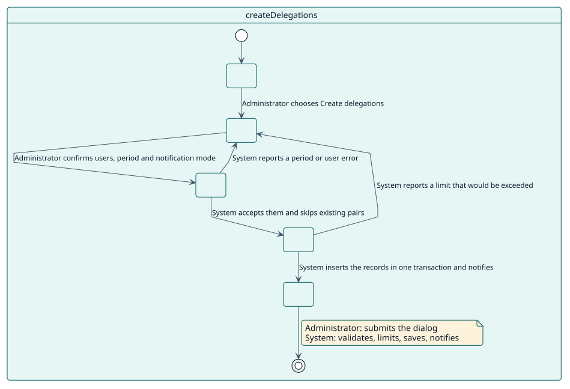
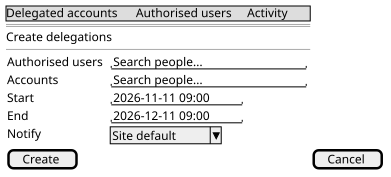

# UC-001 Create delegations

| Overview | Requirements | Analysis | Design | Implementation | Tests |
| --- | --- | --- | --- | --- | --- |
| [Use cases](../../use-case-overview.svg) | **Requirements** | [Analysis](../../../analysis/use-cases/createDelegations/README.md) | [Design](../../../design/use-cases/createDelegations/README.md) | [Implementation](../../../implementation/use-cases/createDelegations/README.md) | [Tests](../../../implementation/use-cases/createDelegations/README.md#tests) |

## Use-case information

| Field | Value |
| --- | --- |
| Actor | Administrator |
| Package | Delegations |
| Goal | Authorise people to use other accounts, for a period, one by one or in bulk. |
| Type | Primary, essential |
| Level | User goal |
| Requirement | RF-001, RF-007 |
| Domain entities | Delegation, AuthorisedUser, DelegatedAccount, SiteLimits, Notification |

## Context

Some people need to work inside another person's account: support fixing a profile, an assistant managing a calendar. The administrator authorises each pair explicitly and for a period, instead of giving anyone Moodle's unlimited **Log in as**.

## Preconditions

- The administrator holds `local/delegateaccount:create` (a site administrator always does).
- The people to authorise are active and allowed to use delegations.

## Postconditions

- Success: one active or scheduled delegation exists for each new pair; each creation is logged as an event; the people involved are notified when the mode says so.
- Failure: nothing is created, because the whole action runs in one transaction.

## Main flow

| Step | Actor | System |
| --- | --- | --- |
| 1 | Opens **Delegated accounts** and chooses **Create delegations**. | Shows the dialog. |
| 2 | Chooses the authorised users and the accounts, a start, an optional end and the notification mode. | Validates the period and the users. |
| 3 | Confirms. | Skips pairs that already have an active delegation and pairs of a user with themselves. |
| 4 | | Checks the bulk limit and the limit of delegations per person. |
| 5 | | Inserts one record per new pair in one transaction and triggers `delegation_created` for each. |
| 6 | | Sends the notifications and shows how many delegations were created. |

## Alternative flows

| ID | Starts at step | Condition | Behaviour | Ends |
| --- | --- | --- | --- | --- |
| A1 | 2 | The end is before the start, the period is longer than the maximum, or no end is allowed and none was given. | Shows the error and keeps the dialog open. | Step 2 |
| A2 | 3 | Every pair already has an active delegation. | Creates nothing and says so. | End |
| A3 | 4 | The action would exceed the bulk limit or the limit of a person. | Shows the error; nothing is created. | Step 2 |

## Business rules

| ID | Rule |
| --- | --- |
| RN-002 | One active delegation per pair. |
| RN-005 | Limits per person and per bulk action. |

## Specification

Behaviour source of truth: [specification.puml](./specification.puml)

## Wireframes

## Pending

| Question | Blocks |
| --- | --- |
| Is an end date mandatory by policy, or only by the `allowopenended` setting? See [Q-001](../../../quality/open-questions.md). | A1 |
