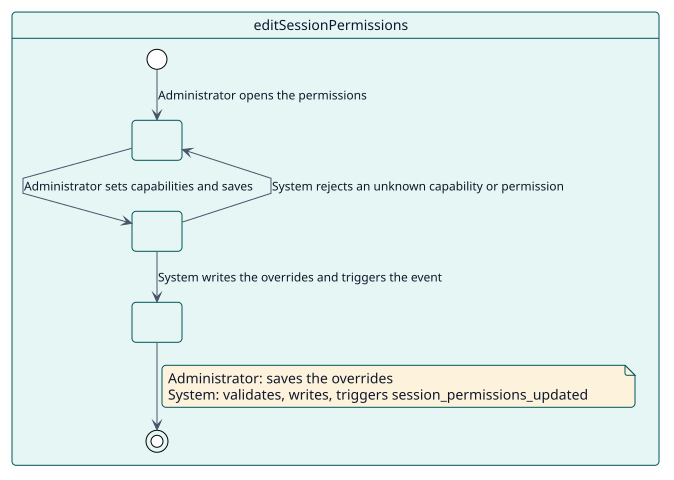
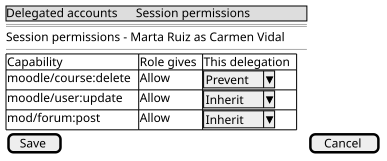

# UC-003 Edit session permissions

| Overview | Requirements | Analysis | Design | Implementation | Tests |
| --- | --- | --- | --- | --- | --- |
| [Use cases](../../use-case-overview.svg) | **Requirements** | [Analysis](../../../analysis/use-cases/editSessionPermissions/README.md) | [Design](../../../design/use-cases/editSessionPermissions/README.md) | [Implementation](../../../implementation/use-cases/editSessionPermissions/README.md) | [Tests](../../../implementation/use-cases/editSessionPermissions/README.md#tests) |

## Use-case information

| Field | Value |
| --- | --- |
| Actor | Administrator |
| Package | Sessions |
| Goal | Limit or widen what a delegated session may do, without creating roles. |
| Type | Primary, essential |
| Level | User goal |
| Requirement | RF-005, RNF-002 |
| Domain entities | SessionPermission, Delegation, DelegatedSession |

## Context

A delegated session has the permissions of the account it opens. An administrator may want it to do less (an assistant must not delete courses) or, rarely, more. Overrides do that for one delegation or for every delegated session of the site.

## Preconditions

- The administrator holds `local/delegateaccount:managepermissions`. No role gets it by default, because it can give a session capabilities its account does not have.

## Postconditions

- Success: one override per capability is stored; sessions that are open apply it from their next page.
- Failure: nothing changes.

## Main flow

| Step | Actor | System |
| --- | --- | --- |
| 1 | Opens the permissions of a delegation, or the site defaults. | Shows each capability with its effective permission. |
| 2 | Sets a capability to allow, prevent or prohibit, or back to inherit. | Validates the changes. |
| 3 | Saves. | Writes the overrides, triggers `session_permissions_updated` and clears what was cached. |

## Alternative flows

| ID | Starts at step | Condition | Behaviour | Ends |
| --- | --- | --- | --- | --- |
| A1 | 2 | A capability does not exist or a permission is not allow, prevent or prohibit. | Rejects the change. | Step 2 |
| A2 | 1 | The administrator wants to copy the permissions of one delegation to others. | Copies them, replacing or merging. | End |

## Business rules

| ID | Rule |
| --- | --- |
| RN-007 | Overrides are re-applied on every request of a delegated session. |

## Specification

Behaviour source of truth: [specification.puml](./specification.puml)

## Wireframes

## Pending

| Question | Blocks |
| --- | --- |
| Should widening a capability (allow) need a second confirmation? See [Q-002](../../../quality/open-questions.md). | |
