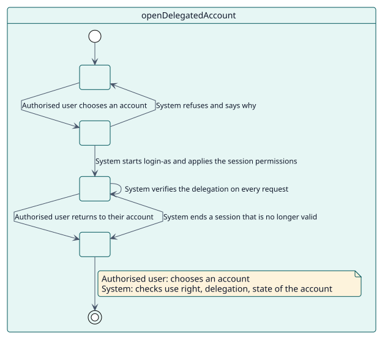
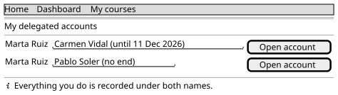

# UC-002 Open a delegated account

| Overview | Requirements | Analysis | Design | Implementation | Tests |
| --- | --- | --- | --- | --- | --- |
| [Use cases](../../use-case-overview.svg) | **Requirements** | [Analysis](../../../analysis/use-cases/openDelegatedAccount/README.md) | [Design](../../../design/use-cases/openDelegatedAccount/README.md) | [Implementation](../../../implementation/use-cases/openDelegatedAccount/README.md) | [Tests](../../../implementation/use-cases/openDelegatedAccount/README.md#tests) |

## Use-case information

| Field | Value |
| --- | --- |
| Actor | Authorised user |
| Package | Sessions |
| Goal | Work inside an account the user is delegated, and leave it. |
| Type | Primary, essential |
| Level | User goal |
| Requirement | RF-003, RF-004 |
| Domain entities | Delegation, AuthorisedUser, DelegatedAccount, DelegatedSession, SessionPermission |

## Context

The authorised user needs to see or do something as another person. The plugin lets them do it through Moodle's own login-as, but only while the delegation is valid, and it keeps checking.

## Preconditions

- The user is signed in, active, and a site administrator or holder of `local/delegateaccount:use`.
- An active delegation exists from the user to the account.

## Postconditions

- Success: the user works as the account; Moodle's log records every action under both names; the session is marked with its delegation.
- Failure: the user stays in their own account and sees why access was refused.

## Main flow

| Step | Actor | System |
| --- | --- | --- |
| 1 | Opens **Delegated accounts** in the user menu. | Lists the accounts the user may open, from their active delegations. |
| 2 | Chooses an account. | Re-checks the use right, the delegation, the state of the account and the administrator protection. |
| 3 | | Starts Moodle's login-as, marks `$SESSION` with the delegation id and applies the session permissions. |
| 4 | Works in the account. | On each request verifies the delegation and re-applies the permissions. |
| 5 | Chooses **Return to my account**. | Ends the login-as session. |

## Alternative flows

| ID | Starts at step | Condition | Behaviour | Ends |
| --- | --- | --- | --- | --- |
| A1 | 2 | The user is not allowed or the delegation does not exist. | Refuses with `error_unauthorised`. | End |
| A2 | 2 | The account is deleted, suspended or the guest. | Refuses with `error_targetunavailable`. | End |
| A3 | 2 | The account is a site administrator and the protection is on. | Refuses with `error_privilegedtarget`. | End |
| A4 | 4 | The delegation is revoked, expires or the account is suspended. | Logs the user out and explains why on the login page. | End |

## Business rules

| ID | Rule |
| --- | --- |
| RN-003 | Access is checked every time. |
| RN-004 | Administrators are protected by default. |
| RN-006 | A session that stops being valid is ended. |

## Specification

Behaviour source of truth: [specification.puml](./specification.puml)

## Wireframes

