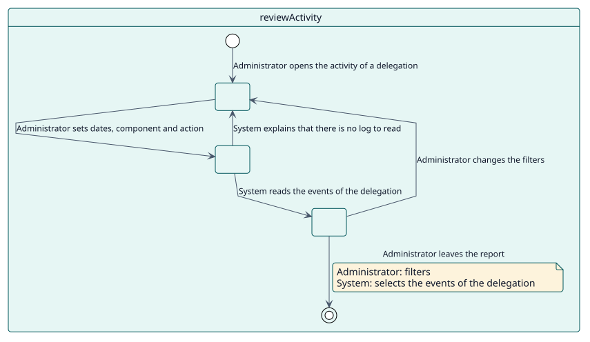
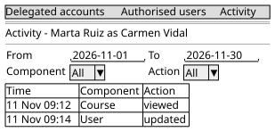

# UC-005 Review delegated activity

| Overview | Requirements | Analysis | Design | Implementation | Tests |
| --- | --- | --- | --- | --- | --- |
| [Use cases](../../use-case-overview.svg) | **Requirements** | [Analysis](../../../analysis/use-cases/reviewActivity/README.md) | [Design](../../../design/use-cases/reviewActivity/README.md) | [Implementation](../../../implementation/use-cases/reviewActivity/README.md) | [Tests](../../../implementation/use-cases/reviewActivity/README.md#tests) |

## Use-case information

| Field | Value |
| --- | --- |
| Actor | Administrator |
| Package | Audit |
| Goal | See what was done through a delegation. |
| Type | Primary, essential |
| Level | User goal |
| Requirement | RF-006 |
| Domain entities | Delegation, DelegatedSession, ActivityRecord |

## Context

Whoever allows access has to be able to see how it was used. The report lists the events that Moodle recorded in the account while the delegation was valid, under both names.

## Preconditions

- The administrator holds `local/delegateaccount:viewactivity`.
- An SQL log store is enabled.

## Postconditions

- Success: the events of the account, inside the period of the delegation, are listed with date, component and action.
- Failure: the report says that there is no log to read.

## Main flow

| Step | Actor | System |
| --- | --- | --- |
| 1 | Opens the **Activity** of a delegation. | Shows the filters and the period of the delegation. |
| 2 | Sets dates, component and action. | Reads the events of the account inside the period. |
| 3 |  | Lists them page by page, newest first. |

## Alternative flows

| ID | Starts at step | Condition | Behaviour | Ends |
| --- | --- | --- | --- | --- |
| A1 | 2 | No SQL log store is enabled. | Explains that there is nothing to read. | Step 1 |
| A2 | 2 | The dates are outside the period. | Clamps them to the start and the end of the delegation. | Step 3 |

## Business rules

| ID | Rule |
| --- | --- |
| RN-012 | The results are limited to the start and the end of the delegation. |

## Specification

Behaviour source of truth: [specification.puml](./specification.puml)

## Wireframes

