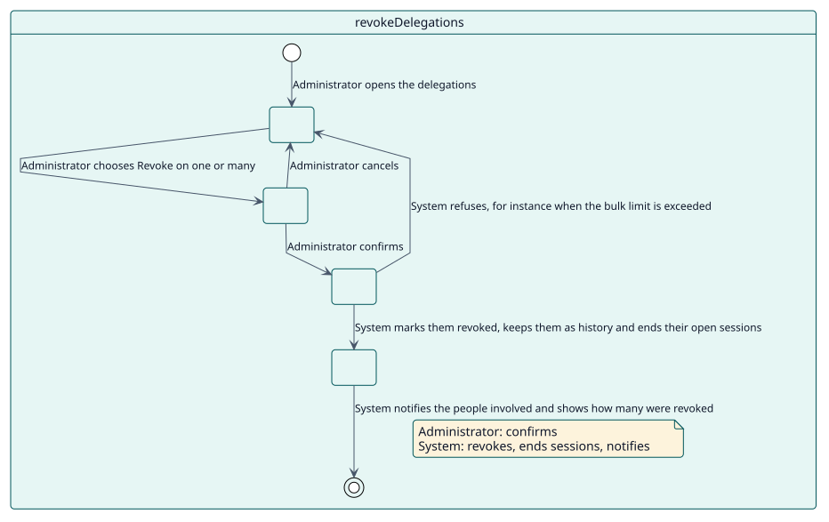
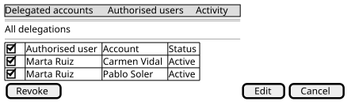

# UC-004 Revoke delegations

| Overview | Requirements | Analysis | Design | Implementation | Tests |
| --- | --- | --- | --- | --- | --- |
| [Use cases](../../use-case-overview.svg) | **Requirements** | [Analysis](../../../analysis/use-cases/revokeDelegations/README.md) | [Design](../../../design/use-cases/revokeDelegations/README.md) | [Implementation](../../../implementation/use-cases/revokeDelegations/README.md) | [Tests](../../../implementation/use-cases/revokeDelegations/README.md#tests) |

## Use-case information

| Field | Value |
| --- | --- |
| Actor | Administrator |
| Package | Delegations |
| Goal | End one or many delegations at once, keeping them as history. |
| Type | Primary, essential |
| Level | User goal |
| Requirement | RF-002 |
| Domain entities | Delegation, DelegatedSession, Notification, SiteLimits |

## Context

Access that was given must be able to end the moment it stops being right. Revoking ends the delegation and the sessions that are open through it, and keeps the record.

## Preconditions

- The administrator holds `local/delegateaccount:revoke` (a site administrator always does).
- The delegations are active or scheduled.

## Postconditions

- Success: each delegation is marked revoked and kept as history, its open sessions have ended and the people involved are notified when the mode says so.
- Failure: nothing is revoked.

## Main flow

| Step | Actor | System |
| --- | --- | --- |
| 1 | Chooses one or many delegations and **Revoke**. | Asks for confirmation in a window. |
| 2 | Confirms. | Checks the limit of records per bulk action. |
| 3 |  | Marks each delegation revoked, with who and when, in one transaction, and triggers `delegation_revoked` for each. |
| 4 |  | Ends the sessions that are open through them. |
| 5 |  | Sends the notifications and shows how many were revoked. |

## Alternative flows

| ID | Starts at step | Condition | Behaviour | Ends |
| --- | --- | --- | --- | --- |
| A1 | 1 | The administrator cancels. | Closes the window and changes nothing. | Step 1 |
| A2 | 2 | The action would exceed the bulk limit. | Shows the error; nothing is revoked. | Step 1 |
| A3 | 3 | A delegation is already revoked. | Leaves it out; the others are revoked. | Step 4 |

## Business rules

| ID | Rule |
| --- | --- |
| RN-010 | A revoked delegation stays as history and can never be used again; the same pair can be delegated again. |
| RN-011 | Revoking ends the sessions that are open through the delegation at once. |

## Specification

Behaviour source of truth: [specification.puml](./specification.puml)

## Wireframes

