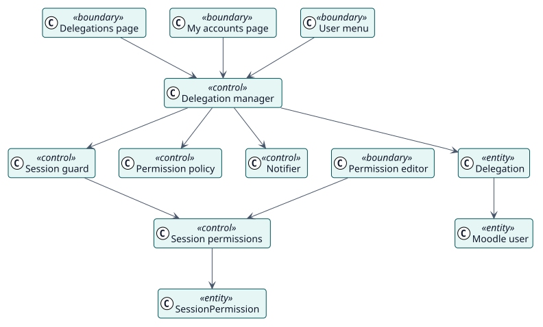

# Análisis

## Clases de análisis

Estereotipos: `<<boundary>>` interfaz, `<<control>>` coordinación, `<<entity>>` información del dominio.

| Clase | Estereotipo | Responsabilidad |
| --- | --- | --- |
| Página de delegaciones, Mis cuentas, Editor de permisos, Menú de usuario | frontera | Las pantallas con las que trabajan administradores y personas autorizadas. |
| Gestor de delegaciones | control | Crea, actualiza y revoca delegaciones, decide si se permite el acceso e inicia la sesión. |
| Vigilante de sesión | control | Verifica una sesión delegada en cada petición y la cierra cuando deja de ser válida. |
| Política de permisos | control | Asigna a cada acción del plugin su capacidad. |
| Permisos de sesión | control | Guarda las sobrescrituras y las aplica a los datos de acceso de una sesión. |
| Notificador | control | Construye y envía los mensajes sobre una delegación. |
| Delegación, Permiso de sesión | entidad | La información guardada. |

## Realizaciones de los casos de uso

| ID | Caso de uso | Colaboración |
| --- | --- | --- |
| UC-001 | [Crear delegaciones](./use-cases/createDelegations/README.md) | [colaboración](./use-cases/createDelegations/collaboration.svg) |
| UC-002 | [Abrir una cuenta delegada](./use-cases/openDelegatedAccount/README.md) | [colaboración](./use-cases/openDelegatedAccount/collaboration.svg) |
| UC-003 | [Editar los permisos de sesión](./use-cases/editSessionPermissions/README.md) | [colaboración](./use-cases/editSessionPermissions/collaboration.svg) |
| UC-004 | [Revocar delegaciones](./use-cases/revokeDelegations/README.md) | [colaboración](./use-cases/revokeDelegations/collaboration.svg) |
| UC-005 | [Revisar la actividad delegada](./use-cases/reviewActivity/README.md) | [colaboración](./use-cases/reviewActivity/collaboration.svg) |
