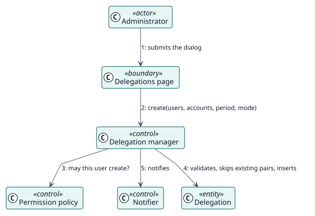

# UC-001 Crear delegaciones — realización del análisis

| Resumen | Requisitos | Análisis | Diseño | Implementación | Pruebas |
| --- | --- | --- | --- | --- | --- |
| [Casos de uso](../../../requirements/use-case-overview.svg) | [Requisitos](../../../requirements/use-cases/createDelegations/README.md) | **Análisis** | [Diseño](../../../design/use-cases/createDelegations/README.md) | [Implementación](../../../implementation/use-cases/createDelegations/README.md) | [Pruebas](../../../implementation/use-cases/createDelegations/README.md#pruebas) |

Requisitos: [README](../../../requirements/use-cases/createDelegations/README.md)

## Clases participantes

| Clase | Estereotipo | Responsabilidad |
| --- | --- | --- |
| Página de delegaciones | frontera | Recoge usuarios, cuentas, periodo y modo. |
| Gestor de delegaciones | control | Valida, aplica los límites e inserta en una transacción. |
| Política de permisos | control | Comprueba la capacidad de crear. |
| Notificador | control | Envía los mensajes cuando la transacción se ha confirmado. |
| Delegación | entidad | El registro guardado. |

## Colaboración

## Notas

Omitir los pares que ya existen y las delegaciones de uno mismo es una regla del gestor, no de la pantalla. La notificación se envía después de confirmar, así que un mensaje fallido nunca deshace una delegación.
