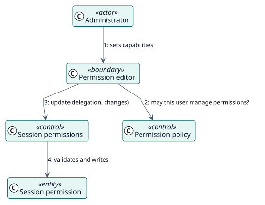

# UC-003 Editar los permisos de sesión — realización del análisis

| Resumen | Requisitos | Análisis | Diseño | Implementación | Pruebas |
| --- | --- | --- | --- | --- | --- |
| [Casos de uso](../../../requirements/use-case-overview.svg) | [Requisitos](../../../requirements/use-cases/editSessionPermissions/README.md) | **Análisis** | [Diseño](../../../design/use-cases/editSessionPermissions/README.md) | [Implementación](../../../implementation/use-cases/editSessionPermissions/README.md) | [Pruebas](../../../implementation/use-cases/editSessionPermissions/README.md#pruebas) |

Requisitos: [README](../../../requirements/use-cases/editSessionPermissions/README.md)

## Clases participantes

| Clase | Estereotipo | Responsabilidad |
| --- | --- | --- |
| Editor de permisos | frontera | Muestra y edita las sobrescrituras. |
| Política de permisos | control | Comprueba `managepermissions`. |
| Permisos de sesión | control | Valida, guarda y aplica las sobrescrituras. |
| Permiso de sesión | entidad | Una sobrescritura de una capacidad. |

## Colaboración

## Notas

Las sobrescrituras se aplican a los datos de acceso de la sesión en cada petición, no se incorporan a un rol, así que un cambio llega a las sesiones abiertas desde su página siguiente.
