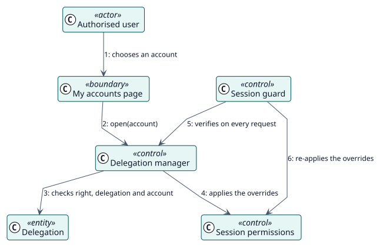

# UC-002 Abrir una cuenta delegada — realización del análisis

| Resumen | Requisitos | Análisis | Diseño | Implementación | Pruebas |
| --- | --- | --- | --- | --- | --- |
| [Casos de uso](../../../requirements/use-case-overview.svg) | [Requisitos](../../../requirements/use-cases/openDelegatedAccount/README.md) | **Análisis** | [Diseño](../../../design/use-cases/openDelegatedAccount/README.md) | [Implementación](../../../implementation/use-cases/openDelegatedAccount/README.md) | [Pruebas](../../../implementation/use-cases/openDelegatedAccount/README.md#pruebas) |

Requisitos: [README](../../../requirements/use-cases/openDelegatedAccount/README.md)

## Clases participantes

| Clase | Estereotipo | Responsabilidad |
| --- | --- | --- |
| Página Mis cuentas | frontera | Lista las cuentas e inicia la sesión. |
| Gestor de delegaciones | control | Decide el acceso e inicia el acceso como otro usuario. |
| Vigilante de sesión | control | Verifica la sesión en cada petición. |
| Permisos de sesión | control | Aplica las sobrescrituras a la sesión. |
| Delegación | entidad | El registro que permite la sesión. |

## Colaboración

## Notas

La marca de una sesión delegada vive en `$SESSION` y no en una caché, porque Moodle sustituye `$SESSION` al iniciar el acceso como otro usuario. Las mismas comprobaciones se hacen al iniciar la sesión y en cada petición posterior.
