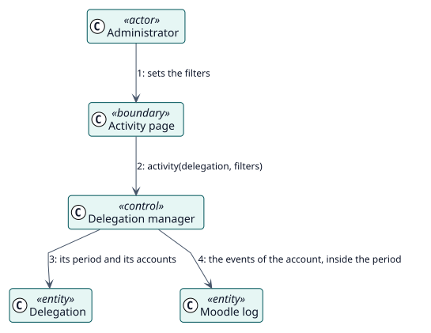

# UC-005 Revisar la actividad delegada — realización del análisis

| Resumen | Requisitos | Análisis | Diseño | Implementación | Pruebas |
| --- | --- | --- | --- | --- | --- |
| [Casos de uso](../../../requirements/use-case-overview.svg) | [Requisitos](../../../requirements/use-cases/reviewActivity/README.md) | **Análisis** | [Diseño](../../../design/use-cases/reviewActivity/README.md) | [Implementación](../../../implementation/use-cases/reviewActivity/README.md) | [Pruebas](../../../implementation/use-cases/reviewActivity/README.md#pruebas) |

Requisitos: [README](../../../requirements/use-cases/reviewActivity/README.md)

## Clases participantes

| Clase | Estereotipo | Responsabilidad |
| --- | --- | --- |
| Página de actividad | frontera | Recoge los filtros y muestra los eventos. |
| Gestor de delegaciones | control | Selecciona los eventos de la cuenta en el periodo. |
| Delegación | entidad | Da el periodo y las cuentas. |
| Registro de Moodle | entidad | Guarda los eventos. |

## Colaboración

## Notas

El plugin lee el registro de Moodle y no escribe ninguno propio para este informe.
