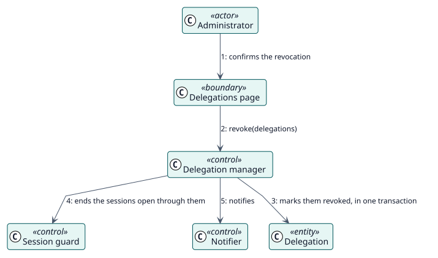

# UC-004 Revocar delegaciones — realización del análisis

| Resumen | Requisitos | Análisis | Diseño | Implementación | Pruebas |
| --- | --- | --- | --- | --- | --- |
| [Casos de uso](../../../requirements/use-case-overview.svg) | [Requisitos](../../../requirements/use-cases/revokeDelegations/README.md) | **Análisis** | [Diseño](../../../design/use-cases/revokeDelegations/README.md) | [Implementación](../../../implementation/use-cases/revokeDelegations/README.md) | [Pruebas](../../../implementation/use-cases/revokeDelegations/README.md#pruebas) |

Requisitos: [README](../../../requirements/use-cases/revokeDelegations/README.md)

## Clases participantes

| Clase | Estereotipo | Responsabilidad |
| --- | --- | --- |
| Página de delegaciones | frontera | Elige las delegaciones y pide confirmación. |
| Gestor de delegaciones | control | Revoca en una transacción. |
| Vigilante de sesión | control | Termina las sesiones abiertas por las delegaciones. |
| Notificador | control | Envía los mensajes cuando la transacción se ha confirmado. |
| Delegación | entidad | El registro, ahora revocado. |

## Colaboración

## Notas

Las sesiones se terminan después de confirmar la transacción; una sesión que no se recordó termina igualmente en su siguiente petición, porque cada petición se comprueba.
