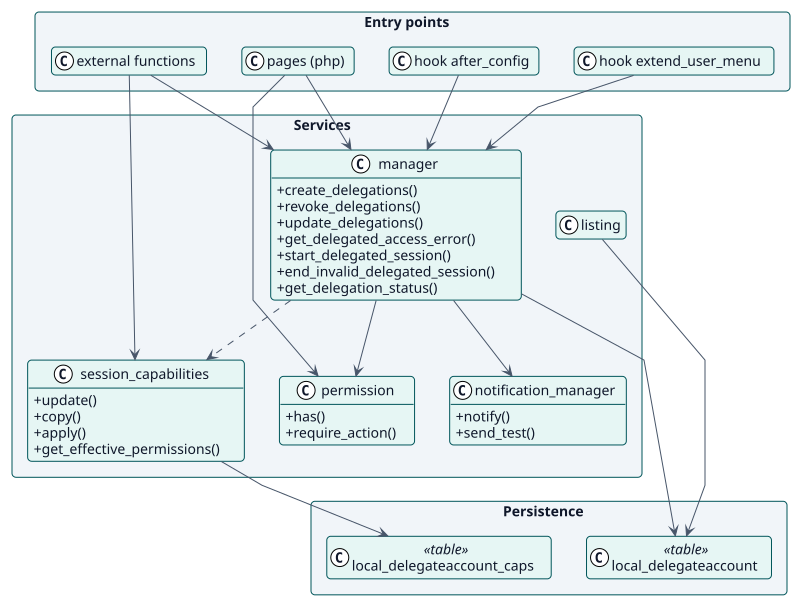
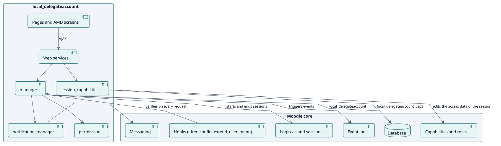
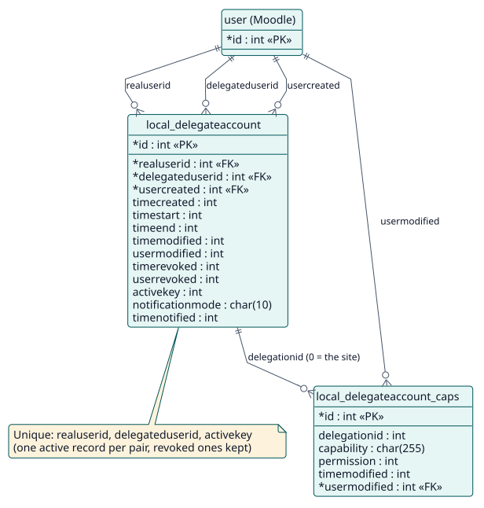

# Diseño

## Arquitectura

Delegate Account es un plugin local de Moodle con tres capas:

- **Puntos de entrada**: funciones de servicio web (`classes/external/`), páginas (`pages/`) y dos hooks (`after_config`, `extend_user_menu`).
- **Servicios**: clases estáticas en `classes/`. `manager` guarda las reglas de las delegaciones, `session_capabilities` guarda y aplica las sobrescrituras, `notification_manager` envía mensajes y `permission` asigna a cada acción su capacidad.
- **Persistencia**: dos tablas, `local_delegateaccount` y `local_delegateaccount_caps`.

Dos decisiones dan forma al diseño. La primera: el acceso se **reevalúa en cada petición** mediante un hook, de modo que una delegación revocada cierra sus sesiones sin ninguna tarea en segundo plano. La segunda: los permisos de sesión se **aplican a los datos de acceso de la sesión**, no se guardan en roles, así que se pueden cambiar con sesiones abiertas y nunca dejan un rol olvidado.

## Clases de diseño

## Componentes

El plugin se apoya en cinco partes de Moodle: el acceso como otro usuario, el sistema de capacidades, el registro de eventos, la mensajería y la base de datos. No añade ninguna tabla a ellas ni cambia el núcleo.

## Modelo de datos

## Realizaciones de los casos de uso

| ID | Caso de uso | Secuencia |
| --- | --- | --- |
| UC-001 | [Crear delegaciones](./use-cases/createDelegations/README.md) | [secuencia](./use-cases/createDelegations/sequence.svg) |
| UC-002 | [Abrir una cuenta delegada](./use-cases/openDelegatedAccount/README.md) | [secuencia](./use-cases/openDelegatedAccount/sequence.svg) |
| UC-003 | [Editar los permisos de sesión](./use-cases/editSessionPermissions/README.md) | [secuencia](./use-cases/editSessionPermissions/sequence.svg) |
