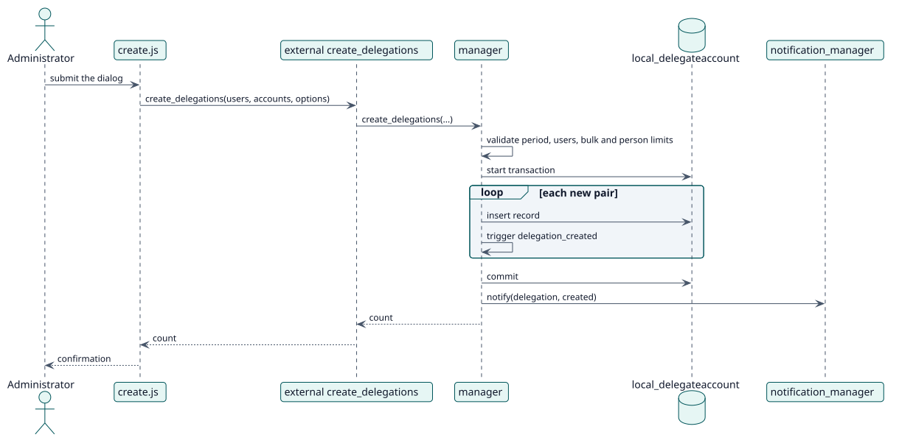

# UC-001 Crear delegaciones — realización del diseño

| Resumen | Requisitos | Análisis | Diseño | Implementación | Pruebas |
| --- | --- | --- | --- | --- | --- |
| [Casos de uso](../../../requirements/use-case-overview.svg) | [Requisitos](../../../requirements/use-cases/createDelegations/README.md) | [Análisis](../../../analysis/use-cases/createDelegations/README.md) | **Diseño** | [Implementación](../../../implementation/use-cases/createDelegations/README.md) | [Pruebas](../../../implementation/use-cases/createDelegations/README.md#pruebas) |

Análisis: [README](../../../analysis/use-cases/createDelegations/README.md)

## Elementos

| Elemento de diseño | Tipo | Código |
| --- | --- | --- |
| Función web `create_delegations` | servicio | `classes/external/create_delegations.php` |
| `manager::create_delegations` | servicio | `classes/manager.php` |
| `manager::validate_users`, `validate_period`, `validate_delegation_limit` | validación | `classes/manager.php` |
| `notification_manager::notify` | servicio | `classes/notification_manager.php` |
| Evento `delegation_created` | evento | `classes/event/delegation_created.php` |

## Secuencia

## Contratos

| Operación | Entrada | Salida | Errores |
| --- | --- | --- | --- |
| `create_delegations(realuserids, delegateduserids, options)` | ids de usuario, `timestart`, `timeend`, `notificationmode` | número de delegaciones creadas | periodo no válido, usuarios no válidos, límite de la acción, límite por persona |

## Datos que toca

| Tabla o entidad | Operación |
| --- | --- |
| `local_delegateaccount` | inserción |
| `user` | lectura |
| `logstore_standard_log` | inserción (un evento por delegación) |
