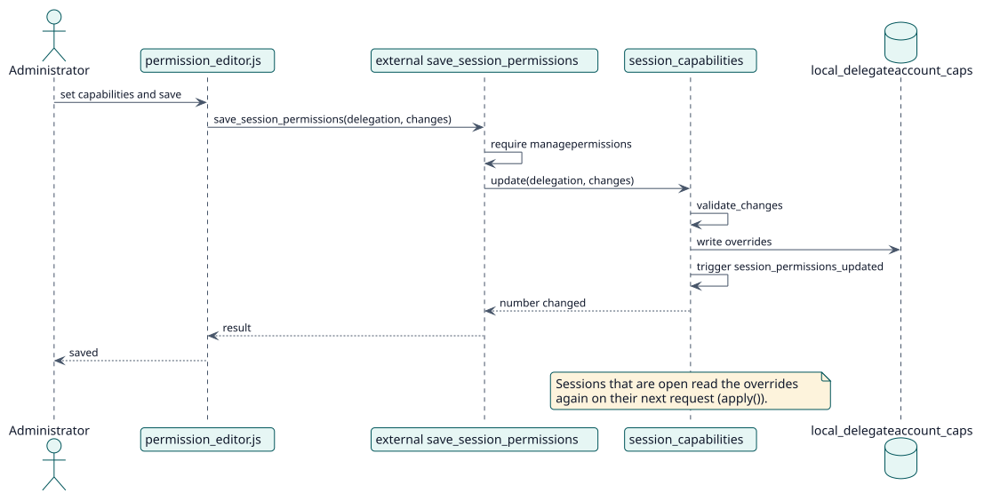

# UC-003 Editar los permisos de sesión — realización del diseño

| Resumen | Requisitos | Análisis | Diseño | Implementación | Pruebas |
| --- | --- | --- | --- | --- | --- |
| [Casos de uso](../../../requirements/use-case-overview.svg) | [Requisitos](../../../requirements/use-cases/editSessionPermissions/README.md) | [Análisis](../../../analysis/use-cases/editSessionPermissions/README.md) | **Diseño** | [Implementación](../../../implementation/use-cases/editSessionPermissions/README.md) | [Pruebas](../../../implementation/use-cases/editSessionPermissions/README.md#pruebas) |

Análisis: [README](../../../analysis/use-cases/editSessionPermissions/README.md)

## Elementos

| Elemento de diseño | Tipo | Código |
| --- | --- | --- |
| Funciones web `save_session_permissions` y `update_session_permissions` | servicio | `classes/external/` |
| `session_capabilities::update`, `replace`, `update_many`, `copy` | servicio | `classes/session_capabilities.php` |
| `session_capabilities::apply` | servicio | `classes/session_capabilities.php` |
| Evento `session_permissions_updated` | evento | `classes/event/session_permissions_updated.php` |

## Secuencia

## Contratos

| Operación | Entrada | Salida | Errores |
| --- | --- | --- | --- |
| `session_capabilities::update(delegationid, changes)` | id de delegación (0 es el sitio), mapa de capacidad a permiso | número de sobrescrituras cambiadas | capacidad desconocida, permiso no válido |

## Datos que toca

| Tabla o entidad | Operación |
| --- | --- |
| `local_delegateaccount_caps` | inserción, actualización, borrado |
| `capabilities` | lectura |
