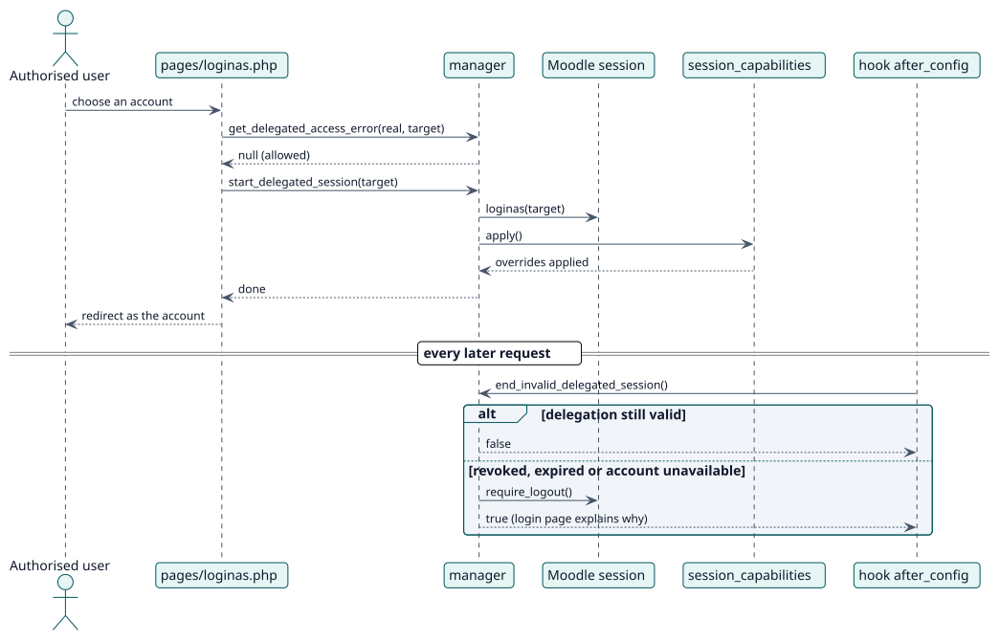

# UC-002 Abrir una cuenta delegada — realización del diseño

| Resumen | Requisitos | Análisis | Diseño | Implementación | Pruebas |
| --- | --- | --- | --- | --- | --- |
| [Casos de uso](../../../requirements/use-case-overview.svg) | [Requisitos](../../../requirements/use-cases/openDelegatedAccount/README.md) | [Análisis](../../../analysis/use-cases/openDelegatedAccount/README.md) | **Diseño** | [Implementación](../../../implementation/use-cases/openDelegatedAccount/README.md) | [Pruebas](../../../implementation/use-cases/openDelegatedAccount/README.md#pruebas) |

Análisis: [README](../../../analysis/use-cases/openDelegatedAccount/README.md)

## Elementos

| Elemento de diseño | Tipo | Código |
| --- | --- | --- |
| `pages/loginas.php` | controlador | `pages/loginas.php` |
| `manager::get_delegated_access_error` | servicio | `classes/manager.php` |
| `manager::start_delegated_session` | servicio | `classes/manager.php` |
| `hook\after_config` | hook | `classes/hook/after_config.php` |
| `hook\extend_user_menu` | hook | `classes/hook/extend_user_menu.php` |

## Secuencia

## Contratos

| Operación | Entrada | Salida | Errores |
| --- | --- | --- | --- |
| `get_delegated_access_error(realuserid, targetuserid)` | dos ids de usuario | null, o el id de una cadena de idioma | `error_unauthorised`, `error_targetunavailable`, `error_privilegedtarget` |

## Datos que toca

| Tabla o entidad | Operación |
| --- | --- |
| `local_delegateaccount` | lectura |
| `user` | lectura |
| `local_delegateaccount_caps` | lectura |
