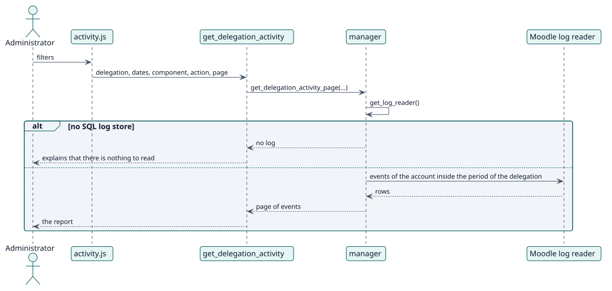

# UC-005 Revisar la actividad delegada — realización del diseño

| Resumen | Requisitos | Análisis | Diseño | Implementación | Pruebas |
| --- | --- | --- | --- | --- | --- |
| [Casos de uso](../../../requirements/use-case-overview.svg) | [Requisitos](../../../requirements/use-cases/reviewActivity/README.md) | [Análisis](../../../analysis/use-cases/reviewActivity/README.md) | **Diseño** | [Implementación](../../../implementation/use-cases/reviewActivity/README.md) | [Pruebas](../../../implementation/use-cases/reviewActivity/README.md#pruebas) |

Análisis: [README](../../../analysis/use-cases/reviewActivity/README.md)

## Elementos

| Elemento de diseño | Tipo | Código |
| --- | --- | --- |
| `manager::get_delegation_activity_page` | servicio | `classes/manager.php:961` |
| `manager::get_delegation_log_selector` | servicio | `classes/manager.php:907` |
| Función externa `get_delegation_activity` | servicio | `classes/external/get_delegation_activity.php` |

## Secuencia

## Contratos

| Operación | Entrada | Salida | Errores |
| --- | --- | --- | --- |
| `get_delegation_activity(delegation, filters, page)` | la delegación, las fechas, el componente, la acción y la página | una página de eventos | delegación no encontrada, sin registro |

## Datos que toca

| Tabla o entidad | Operación |
| --- | --- |
| `logstore_standard_log` | lectura |
| `local_delegateaccount` | lectura |
