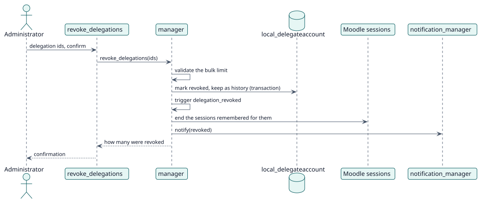

# UC-004 Revocar delegaciones — realización del diseño

| Resumen | Requisitos | Análisis | Diseño | Implementación | Pruebas |
| --- | --- | --- | --- | --- | --- |
| [Casos de uso](../../../requirements/use-case-overview.svg) | [Requisitos](../../../requirements/use-cases/revokeDelegations/README.md) | [Análisis](../../../analysis/use-cases/revokeDelegations/README.md) | **Diseño** | [Implementación](../../../implementation/use-cases/revokeDelegations/README.md) | [Pruebas](../../../implementation/use-cases/revokeDelegations/README.md#pruebas) |

Análisis: [README](../../../analysis/use-cases/revokeDelegations/README.md)

## Elementos

| Elemento de diseño | Tipo | Código |
| --- | --- | --- |
| `manager::revoke_delegations` | servicio | `classes/manager.php:516` |
| `manager::end_sessions` | servicio | `classes/manager.php:354` |
| Función externa `revoke_delegations` | servicio | `classes/external/revoke_delegations.php` |

## Secuencia

## Contratos

| Operación | Entrada | Salida | Errores |
| --- | --- | --- | --- |
| `revoke_delegations(ids, confirm)` | los ids y la confirmación | cuántas se revocaron | límite masivo superado, sin confirmación |

## Datos que toca

| Tabla o entidad | Operación |
| --- | --- |
| `local_delegateaccount` | actualización |
| `logstore_standard_log` | inserción (un evento por delegación) |
| `sessions` | borrado |
