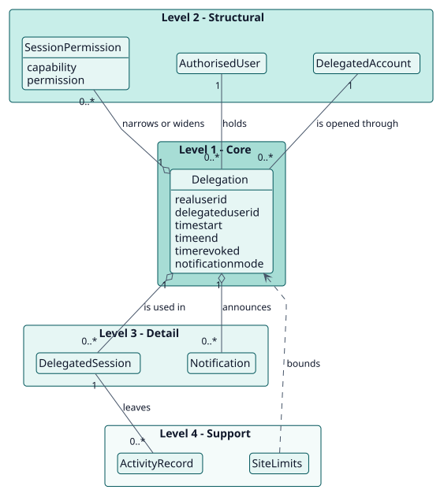
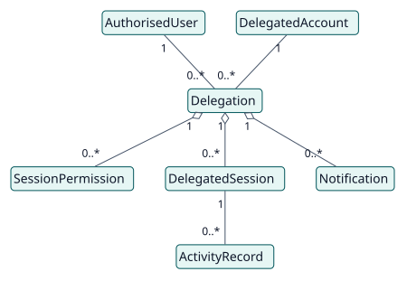
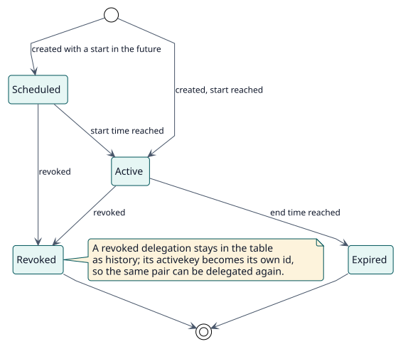

# Modelo de dominio

## Propósito

El **Acceder como** de Moodle deja a un usuario abrir cualquier cuenta que pueda ver, durante el tiempo que quiera. Delegate Account lo limita a pares explícitos de personas, cada uno con un periodo, y registra quién creó, cambió y revocó cada par. Este modelo nombra los conceptos que hay detrás de esa decisión.

## Jerarquía de entidades

La posición vertical de una entidad expresa su importancia para el objetivo del proyecto. No es herencia ni composición UML.

| Nivel | Significado | Entidades | Por qué están aquí |
| --- | --- | --- | --- |
| 1 | Núcleo: el proyecto no puede existir sin ellas | Delegation | El plugin existe para decidir, para un par de usuarios y un momento, si el acceso está permitido. |
| 2 | Estructurales: dependen directamente del núcleo | AuthorisedUser, DelegatedAccount, SessionPermission | Una delegación une dos cuentas y puede restringir o ampliar lo que la sesión puede hacer. |
| 3 | Detalle: cualifican o especializan el nivel 2 | DelegatedSession, Notification | Existen por una delegación: la sesión que la usa y los mensajes que la anuncian. |
| 4 | Soporte: catálogos, auditoría, configuración | SiteLimits, ActivityRecord | Acotan y observan las delegaciones sin cambiar su significado. |

## Diagramas

## Diccionario de entidades

| Entidad | Nivel | Definición | Atributos clave | Atributos omitidos y por qué |
| --- | --- | --- | --- | --- |
| Delegation | 1 | El permiso de una persona autorizada para abrir una cuenta, durante un periodo. | `realuserid`, `delegateduserid`, `timestart`, `timeend`, `timerevoked`, `notificationmode` | Las columnas de auditoría (`usercreated`, `usermodified`, `userrevoked`, `timecreated`, `timemodified`) están en el [modelo de datos](../design/data-model/data-model.svg). |
| AuthorisedUser | 2 | Una persona que puede abrir cuentas delegadas: administradora del sitio o con `local/delegateaccount:use`. | usuario de Moodle, capacidad | Es el `user` de Moodle, no una tabla del plugin. |
| DelegatedAccount | 2 | La cuenta que se abre. Debe existir, estar activa y, por defecto, no ser administradora del sitio. | usuario de Moodle | Es el `user` de Moodle, no una tabla del plugin. |
| SessionPermission | 2 | Una sobrescritura de una capacidad en las sesiones delegadas: permitir, evitar o prohibir. Se aplica a una delegación o, con `delegationid` 0, a todas las sesiones delegadas del sitio. | `delegationid`, `capability`, `permission` | |
| DelegatedSession | 3 | Una sesión de acceso como otro usuario de Moodle iniciada por una delegación, marcada en `$SESSION`. | el id de la delegación | Vive en la sesión, no en una tabla. |
| Notification | 3 | El mensaje enviado a la persona autorizada, a la cuenta delegada o a ambas al crear o revocar una delegación. | acción, idioma del destinatario | Las plantillas son ajustes del plugin. |
| SiteLimits | 4 | Los ajustes del sitio que acotan las delegaciones: máximo por persona, duración máxima, máximo por acción masiva, protección de administradores. | `maxdelegationsperuser`, `maximumdurationdays`, `maxbulkoperations`, `protectprivilegedtargets` | |
| ActivityRecord | 4 | Un evento del registro estándar de Moodle escrito mientras había una sesión delegada abierta, que lee el informe de actividad. | fila del registro de Moodle | Es el registro de Moodle, no una tabla del plugin. |

## Reglas de negocio

| ID | Regla | Entidades | Fuente |
| --- | --- | --- | --- |
| RN-001 | Una delegación está activa cuando no está revocada, ha llegado su inicio y no tiene fin o el fin es futuro. | Delegation | `manager::get_delegation_status` |
| RN-002 | Hay como máximo una delegación activa para un par de usuarios; las revocadas se conservan como historial. | Delegation | índice único `real_delegated_active_unique` |
| RN-003 | El acceso se comprueba cada vez que se pide, no solo al crear la delegación: la persona autorizada debe estar activa y permitida, la delegación debe existir y el destino debe ser una cuenta disponible. | Delegation, AuthorisedUser, DelegatedAccount | `manager::get_delegated_access_error` |
| RN-004 | Una administradora del sitio no se puede abrir como cuenta delegada salvo que se desactive la protección. | DelegatedAccount, SiteLimits | `manager::protect_privileged_targets` |
| RN-005 | Una persona autorizada no puede tener más delegaciones activas que el límite del sitio, y una acción no puede crear más registros que el límite masivo. | Delegation, SiteLimits | `manager::get_delegation_limit_error`, `get_bulk_operation_error` |
| RN-006 | Una sesión delegada que deja de ser válida se cierra en su siguiente petición. | DelegatedSession | `hook\after_config`, `manager::end_invalid_delegated_session` |
| RN-007 | Los permisos de sesión se aplican a las sesiones abiertas desde su página siguiente y se vuelven a aplicar en cada petición. | SessionPermission, DelegatedSession | `session_capabilities::apply` |

## Ciclos de vida

Diagrama de estados de una delegación: [entity-states](./entity-states/entity-states.svg).

