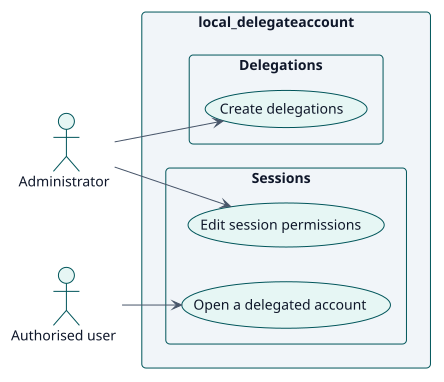
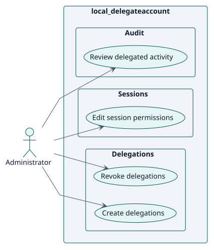
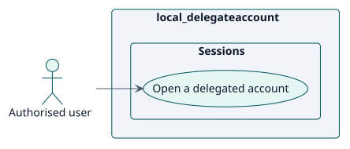

# Requisitos

## Índice

- [Actores](./actors.md)
- [Catálogo de requisitos](./requirements.md)

## Casos de uso

<!-- rup-flow:use-cases:start -->

| ID | Use case | Actor | Package | Requirement | Analysis | Design | Implementation | Status |
| --- | --- | --- | --- | --- | --- | --- | --- | --- |
| UC-001 | [Create delegations](./use-cases/createDelegations/README.md) | Administrator | Delegations | RF-001 | [card](../analysis/use-cases/createDelegations/README.md) | [card](../design/use-cases/createDelegations/README.md) | [card](../implementation/use-cases/createDelegations/README.md) | draft |
| UC-002 | [Open a delegated account](./use-cases/openDelegatedAccount/README.md) | Authorised user | Sessions | RF-003 | [card](../analysis/use-cases/openDelegatedAccount/README.md) | [card](../design/use-cases/openDelegatedAccount/README.md) | [card](../implementation/use-cases/openDelegatedAccount/README.md) | draft |
| UC-003 | [Edit session permissions](./use-cases/editSessionPermissions/README.md) | Administrator | Sessions | RF-005 | [card](../analysis/use-cases/editSessionPermissions/README.md) | [card](../design/use-cases/editSessionPermissions/README.md) | [card](../implementation/use-cases/editSessionPermissions/README.md) | draft |
| UC-004 | [Revoke delegations](./use-cases/revokeDelegations/README.md) | Administrator | Delegations | RF-002 | [card](../analysis/use-cases/revokeDelegations/README.md) | [card](../design/use-cases/revokeDelegations/README.md) | [card](../implementation/use-cases/revokeDelegations/README.md) | draft |
| UC-005 | [Review delegated activity](./use-cases/reviewActivity/README.md) | Administrator | Audit | RF-006 | [card](../analysis/use-cases/reviewActivity/README.md) | [card](../design/use-cases/reviewActivity/README.md) | [card](../implementation/use-cases/reviewActivity/README.md) | draft |

### Use-case diagram

### By actor

#### Administrator

#### Authorised user

<!-- rup-flow:use-cases:end -->

El índice y sus diagramas los genera el comando `index` a partir de las tarjetas de los casos de uso. Edite las tarjetas (cabecera: `actor`, `package`, `includes`, `extends`), no este bloque.

## Convenciones

- `specification.puml` es la fuente de verdad del comportamiento de un caso de uso: un diagrama de estados con la conversación Actor/Sistema.
- `wireframes.puml` es el prototipo de la interfaz, aunque tenga una sola pantalla.
- Cada carpeta de caso de uso tiene `README.md`, `specification.puml` y `wireframes.puml`.
