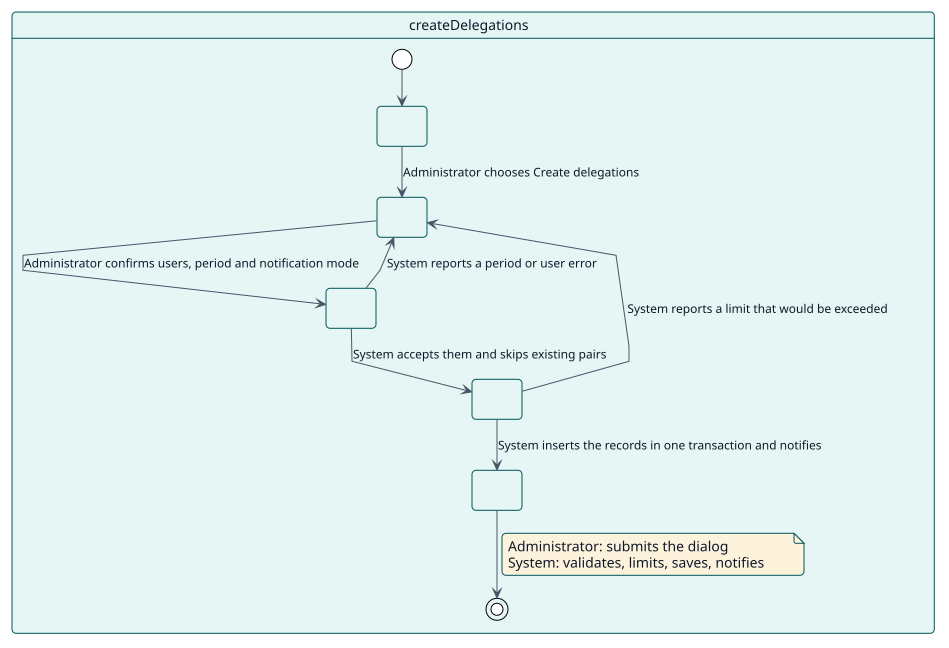
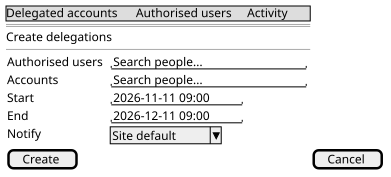

# UC-001 Crear delegaciones

| Resumen | Requisitos | Análisis | Diseño | Implementación | Pruebas |
| --- | --- | --- | --- | --- | --- |
| [Casos de uso](../../use-case-overview.svg) | **Requisitos** | [Análisis](../../../analysis/use-cases/createDelegations/README.md) | [Diseño](../../../design/use-cases/createDelegations/README.md) | [Implementación](../../../implementation/use-cases/createDelegations/README.md) | [Pruebas](../../../implementation/use-cases/createDelegations/README.md#pruebas) |

## Información del caso de uso

| Campo | Valor |
| --- | --- |
| Actor | Administrador |
| Paquete | Delegations |
| Objetivo | Autorizar a personas a usar otras cuentas, durante un periodo, una a una o en bloque. |
| Tipo | Primario, esencial |
| Nivel | Objetivo de usuario |
| Requisito | RF-001, RF-007 |
| Entidades del dominio | Delegation, AuthorisedUser, DelegatedAccount, SiteLimits, Notification |

## Contexto

Algunas personas necesitan trabajar dentro de la cuenta de otra: el soporte que arregla un perfil, una persona asistente que gestiona un calendario. El administrador autoriza cada par de forma explícita y por un periodo, en lugar de dar a alguien el **Acceder como** ilimitado de Moodle.

## Precondiciones

- El administrador tiene `local/delegateaccount:create` (una administradora del sitio siempre lo tiene).
- Las personas a autorizar están activas y pueden usar delegaciones.

## Postcondiciones

- Éxito: existe una delegación activa o programada por cada par nuevo; cada creación queda registrada como evento; se notifica a las personas implicadas si el modo lo indica.
- Fallo: no se crea nada, porque toda la acción se ejecuta en una transacción.

## Flujo principal

| Paso | Actor | Sistema |
| --- | --- | --- |
| 1 | Abre **Cuentas delegadas** y elige **Crear delegaciones**. | Muestra el diálogo. |
| 2 | Elige las personas autorizadas y las cuentas, un inicio, un fin opcional y el modo de notificación. | Valida el periodo y los usuarios. |
| 3 | Confirma. | Omite los pares que ya tienen una delegación activa y los de un usuario consigo mismo. |
| 4 | | Comprueba el límite de la acción masiva y el de delegaciones por persona. |
| 5 | | Inserta un registro por cada par nuevo en una transacción y lanza `delegation_created` por cada uno. |
| 6 | | Envía las notificaciones y muestra cuántas delegaciones se crearon. |

## Flujos alternativos

| ID | Empieza en el paso | Condición | Comportamiento | Termina |
| --- | --- | --- | --- | --- |
| A1 | 2 | El fin es anterior al inicio, el periodo supera el máximo o no se permite un fin abierto y no se dio ninguno. | Muestra el error y mantiene el diálogo abierto. | Paso 2 |
| A2 | 3 | Todos los pares ya tienen una delegación activa. | No crea nada y lo dice. | Fin |
| A3 | 4 | La acción superaría el límite masivo o el de una persona. | Muestra el error; no se crea nada. | Paso 2 |

## Reglas de negocio

| ID | Regla |
| --- | --- |
| RN-002 | Una delegación activa por par. |
| RN-005 | Límites por persona y por acción masiva. |

## Especificación

Fuente de verdad del comportamiento: [specification.puml](./specification.puml)

## Prototipos

## Pendiente

| Pregunta | Bloquea |
| --- | --- |
| ¿Es obligatorio por política un fin, o solo por el ajuste `allowopenended`? Véase [Q-001](../../../quality/open-questions.md). | A1 |
