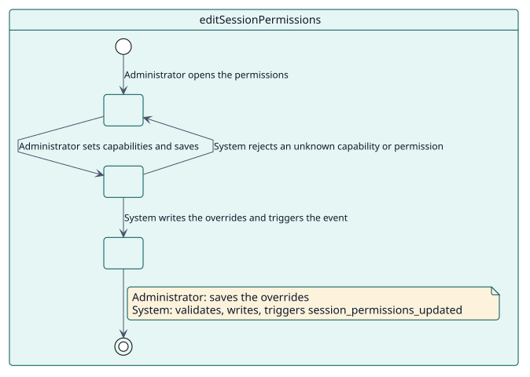
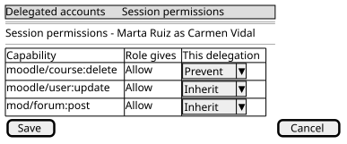

# UC-003 Editar los permisos de sesión

| Resumen | Requisitos | Análisis | Diseño | Implementación | Pruebas |
| --- | --- | --- | --- | --- | --- |
| [Casos de uso](../../use-case-overview.svg) | **Requisitos** | [Análisis](../../../analysis/use-cases/editSessionPermissions/README.md) | [Diseño](../../../design/use-cases/editSessionPermissions/README.md) | [Implementación](../../../implementation/use-cases/editSessionPermissions/README.md) | [Pruebas](../../../implementation/use-cases/editSessionPermissions/README.md#pruebas) |

## Información del caso de uso

| Campo | Valor |
| --- | --- |
| Actor | Administrador |
| Paquete | Sessions |
| Objetivo | Limitar o ampliar lo que puede hacer una sesión delegada, sin crear roles. |
| Tipo | Primario, esencial |
| Nivel | Objetivo de usuario |
| Requisito | RF-005, RNF-002 |
| Entidades del dominio | SessionPermission, Delegation, DelegatedSession |

## Contexto

Una sesión delegada tiene los permisos de la cuenta que abre. Un administrador puede querer que haga menos (una persona asistente no debe borrar cursos) o, rara vez, más. Las sobrescrituras lo hacen para una delegación o para todas las sesiones delegadas del sitio.

## Precondiciones

- El administrador tiene `local/delegateaccount:managepermissions`. Ningún rol la recibe por defecto, porque puede dar a una sesión capacidades que su cuenta no tiene.

## Postcondiciones

- Éxito: se guarda una sobrescritura por capacidad; las sesiones abiertas la aplican desde su página siguiente.
- Fallo: no cambia nada.

## Flujo principal

| Paso | Actor | Sistema |
| --- | --- | --- |
| 1 | Abre los permisos de una delegación, o los del sitio. | Muestra cada capacidad con su permiso efectivo. |
| 2 | Pone una capacidad en permitir, evitar o prohibir, o la devuelve a heredar. | Valida los cambios. |
| 3 | Guarda. | Escribe las sobrescrituras, lanza `session_permissions_updated` y limpia lo que había en caché. |

## Flujos alternativos

| ID | Empieza en el paso | Condición | Comportamiento | Termina |
| --- | --- | --- | --- | --- |
| A1 | 2 | Una capacidad no existe o un permiso no es permitir, evitar o prohibir. | Rechaza el cambio. | Paso 2 |
| A2 | 1 | El administrador quiere copiar los permisos de una delegación a otras. | Los copia, reemplazando o combinando. | Fin |

## Reglas de negocio

| ID | Regla |
| --- | --- |
| RN-007 | Las sobrescrituras se vuelven a aplicar en cada petición de una sesión delegada. |

## Especificación

Fuente de verdad del comportamiento: [specification.puml](./specification.puml)

## Prototipos

