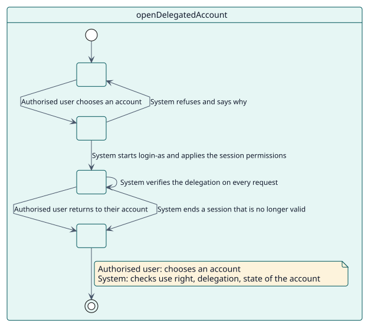
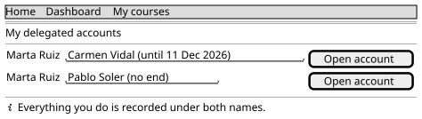

# UC-002 Abrir una cuenta delegada

| Resumen | Requisitos | Análisis | Diseño | Implementación | Pruebas |
| --- | --- | --- | --- | --- | --- |
| [Casos de uso](../../use-case-overview.svg) | **Requisitos** | [Análisis](../../../analysis/use-cases/openDelegatedAccount/README.md) | [Diseño](../../../design/use-cases/openDelegatedAccount/README.md) | [Implementación](../../../implementation/use-cases/openDelegatedAccount/README.md) | [Pruebas](../../../implementation/use-cases/openDelegatedAccount/README.md#pruebas) |

## Información del caso de uso

| Campo | Valor |
| --- | --- |
| Actor | Persona autorizada |
| Paquete | Sessions |
| Objetivo | Trabajar dentro de una cuenta que se le ha delegado y salir de ella. |
| Tipo | Primario, esencial |
| Nivel | Objetivo de usuario |
| Requisito | RF-003, RF-004 |
| Entidades del dominio | Delegation, AuthorisedUser, DelegatedAccount, DelegatedSession, SessionPermission |

## Contexto

La persona autorizada necesita ver o hacer algo como otra persona. El plugin se lo permite mediante el acceso como otro usuario de Moodle, pero solo mientras la delegación es válida, y sigue comprobándolo.

## Precondiciones

- La persona ha iniciado sesión, está activa y es administradora del sitio o tiene `local/delegateaccount:use`.
- Existe una delegación activa de la persona a la cuenta.

## Postcondiciones

- Éxito: la persona trabaja como la cuenta; el registro de Moodle guarda cada acción con ambos nombres; la sesión queda marcada con su delegación.
- Fallo: la persona sigue en su cuenta y ve por qué se rechazó el acceso.

## Flujo principal

| Paso | Actor | Sistema |
| --- | --- | --- |
| 1 | Abre **Cuentas delegadas** en el menú de usuario. | Lista las cuentas que puede abrir, a partir de sus delegaciones activas. |
| 2 | Elige una cuenta. | Vuelve a comprobar el derecho de uso, la delegación, el estado de la cuenta y la protección de administradores. |
| 3 | | Inicia el acceso como otro usuario de Moodle, marca `$SESSION` con el id de la delegación y aplica los permisos de sesión. |
| 4 | Trabaja en la cuenta. | En cada petición verifica la delegación y vuelve a aplicar los permisos. |
| 5 | Elige **Volver a mi cuenta**. | Termina la sesión de acceso como otro usuario. |

## Flujos alternativos

| ID | Empieza en el paso | Condición | Comportamiento | Termina |
| --- | --- | --- | --- | --- |
| A1 | 2 | La persona no tiene permiso o la delegación no existe. | Rechaza con `error_unauthorised`. | Fin |
| A2 | 2 | La cuenta está borrada, suspendida o es la de invitado. | Rechaza con `error_targetunavailable`. | Fin |
| A3 | 2 | La cuenta es de una administradora del sitio y la protección está activa. | Rechaza con `error_privilegedtarget`. | Fin |
| A4 | 4 | La delegación se revoca, caduca o la cuenta se suspende. | Cierra la sesión y explica el motivo en la página de acceso. | Fin |

## Reglas de negocio

| ID | Regla |
| --- | --- |
| RN-003 | El acceso se comprueba cada vez. |
| RN-004 | Las administradoras están protegidas por defecto. |
| RN-006 | Una sesión que deja de ser válida se cierra. |

## Especificación

Fuente de verdad del comportamiento: [specification.puml](./specification.puml)

## Prototipos

