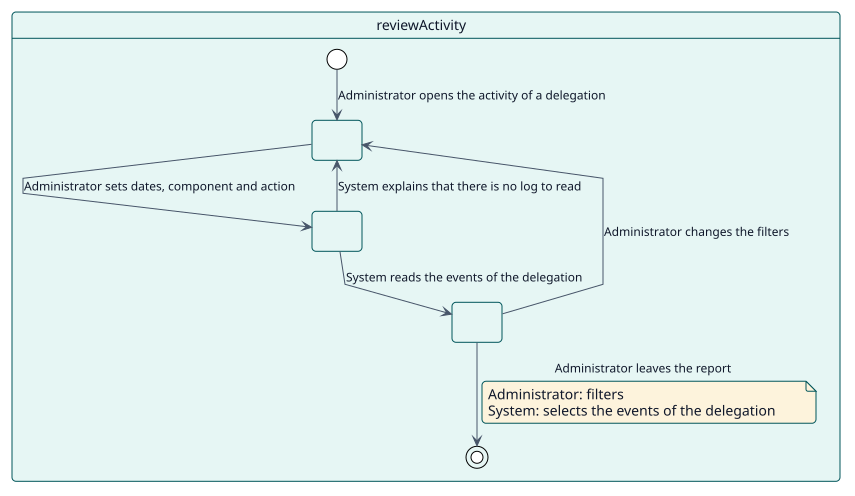
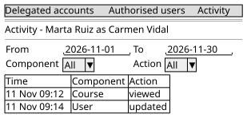

# UC-005 Revisar la actividad delegada

| Resumen | Requisitos | Análisis | Diseño | Implementación | Pruebas |
| --- | --- | --- | --- | --- | --- |
| [Casos de uso](../../use-case-overview.svg) | **Requisitos** | [Análisis](../../../analysis/use-cases/reviewActivity/README.md) | [Diseño](../../../design/use-cases/reviewActivity/README.md) | [Implementación](../../../implementation/use-cases/reviewActivity/README.md) | [Pruebas](../../../implementation/use-cases/reviewActivity/README.md#pruebas) |

## Información del caso de uso

| Campo | Valor |
| --- | --- |
| Actor | Administrador |
| Paquete | Audit |
| Objetivo | Ver lo que se hizo mediante una delegación. |
| Tipo | Primario, esencial |
| Nivel | Objetivo de usuario |
| Requisito | RF-006 |
| Entidades del dominio | Delegation, DelegatedSession, ActivityRecord |

## Contexto

Quien permite un acceso tiene que poder ver cómo se usó. El informe lista los eventos que Moodle registró en la cuenta mientras la delegación era válida, con ambos nombres.

## Precondiciones

- El administrador tiene `local/delegateaccount:viewactivity`.
- Hay un almacén de registros SQL habilitado.

## Postcondiciones

- Éxito: los eventos de la cuenta, dentro del periodo de la delegación, se listan con fecha, componente y acción.
- Fallo: el informe dice que no hay registro que leer.

## Flujo principal

| Paso | Actor | Sistema |
| --- | --- | --- |
| 1 | Abre la **Actividad** de una delegación. | Muestra los filtros y el periodo de la delegación. |
| 2 | Fija fechas, componente y acción. | Lee los eventos de la cuenta dentro del periodo. |
| 3 |  | Los lista por páginas, de más reciente a más antiguo. |

## Flujos alternativos

| ID | Empieza en el paso | Condición | Comportamiento | Termina |
| --- | --- | --- | --- | --- |
| A1 | 2 | No hay almacén de registros SQL habilitado. | Explica que no hay nada que leer. | Paso 1 |
| A2 | 2 | Las fechas quedan fuera del periodo. | Las ajusta al inicio y al fin de la delegación. | Paso 3 |

## Reglas de negocio

| ID | Regla |
| --- | --- |
| RN-012 | Los resultados se limitan al inicio y al fin de la delegación. |

## Especificación

Fuente de verdad del comportamiento: [specification.puml](./specification.puml)

## Prototipos

