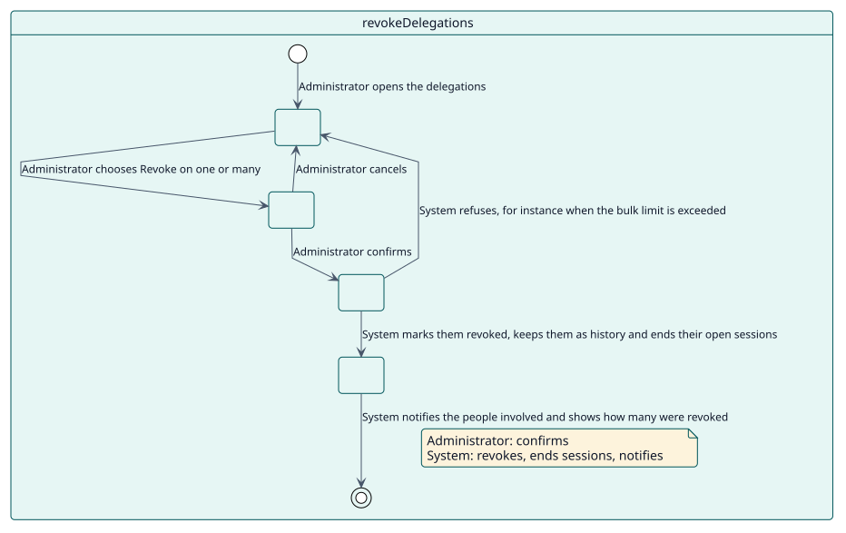
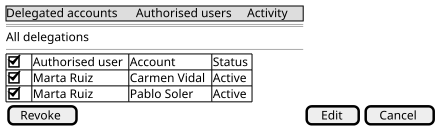

# UC-004 Revocar delegaciones

| Resumen | Requisitos | Análisis | Diseño | Implementación | Pruebas |
| --- | --- | --- | --- | --- | --- |
| [Casos de uso](../../use-case-overview.svg) | **Requisitos** | [Análisis](../../../analysis/use-cases/revokeDelegations/README.md) | [Diseño](../../../design/use-cases/revokeDelegations/README.md) | [Implementación](../../../implementation/use-cases/revokeDelegations/README.md) | [Pruebas](../../../implementation/use-cases/revokeDelegations/README.md#pruebas) |

## Información del caso de uso

| Campo | Valor |
| --- | --- |
| Actor | Administrador |
| Paquete | Delegations |
| Objetivo | Terminar una o varias delegaciones a la vez, conservándolas como historial. |
| Tipo | Primario, esencial |
| Nivel | Objetivo de usuario |
| Requisito | RF-002 |
| Entidades del dominio | Delegation, DelegatedSession, Notification, SiteLimits |

## Contexto

El acceso que se dio debe poder terminar en el momento en que deja de ser correcto. Revocar termina la delegación y las sesiones que están abiertas por ella, y conserva el registro.

## Precondiciones

- El administrador tiene `local/delegateaccount:revoke` (una administradora del sitio siempre la tiene).
- Las delegaciones están activas o programadas.

## Postcondiciones

- Éxito: cada delegación queda marcada como revocada y conservada como historial, sus sesiones abiertas han terminado y las personas implicadas reciben una notificación cuando el modo lo indica.
- Fallo: no se revoca nada.

## Flujo principal

| Paso | Actor | Sistema |
| --- | --- | --- |
| 1 | Elige una o varias delegaciones y **Revocar**. | Pide confirmación en una ventana. |
| 2 | Confirma. | Comprueba el límite de registros por acción masiva. |
| 3 |  | Marca cada delegación como revocada, con quién y cuándo, en una transacción, y lanza `delegation_revoked` por cada una. |
| 4 |  | Termina las sesiones que están abiertas por ellas. |
| 5 |  | Envía las notificaciones y muestra cuántas se revocaron. |

## Flujos alternativos

| ID | Empieza en el paso | Condición | Comportamiento | Termina |
| --- | --- | --- | --- | --- |
| A1 | 1 | El administrador cancela. | Cierra la ventana y no cambia nada. | Paso 1 |
| A2 | 2 | La acción superaría el límite masivo. | Muestra el error; no se revoca nada. | Paso 1 |
| A3 | 3 | Una delegación ya está revocada. | La deja fuera; las demás se revocan. | Paso 4 |

## Reglas de negocio

| ID | Regla |
| --- | --- |
| RN-010 | Una delegación revocada queda como historial y no puede volver a usarse; el mismo par puede delegarse de nuevo. |
| RN-011 | Revocar termina al instante las sesiones que están abiertas por la delegación. |

## Especificación

Fuente de verdad del comportamiento: [specification.puml](./specification.puml)

## Prototipos

